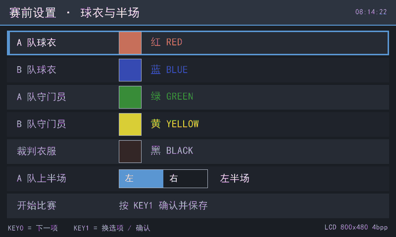
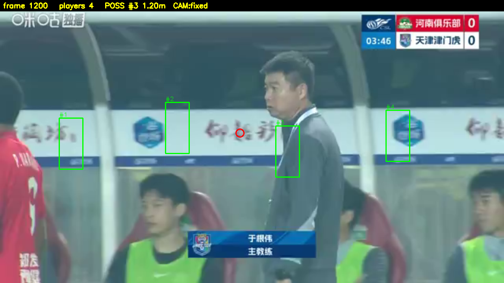

# 基于 Zynq-7020 的足球转播视频目标与事件分析系统

**设计报告（提交稿 v1.3）**

- 日期：2026-10-31（v1.0 为 2026-10-25；v1.1 补 D026 HDMI 带框环出、统一显示判据的两级口径、
  同步 D023–D026 与 2026-10-28–30 的 LCD 重做记录；v1.2 补 10-31 的 HDMI 三处 RTL 缺陷、
  系统级仿真回归与单行/单列几何探针；v1.3 补 10-31 上板两轮实测：取数吞吐缺陷定量与修复
  （黑横条消失、画面不跳），以及读地址错 2 像素造成整幅图右移 —— 修正片待上板）
- 器件：Xilinx XC7Z020-CLG400-2（正点原子 领航者 ZYNQ 7020，底板 V3.7）
- 工具链：Vivado / Vitis / Vitis_HLS 2020.2（本机唯一安装版本；与指南推荐版本的差异见 §7.6）
- 代码与复现入口：[`../README.md`](../README.md)、[`../docs/repo_spec.md`](../docs/repo_spec.md)
- 详细指标口径：[`../docs/system_status.md`](../docs/system_status.md)

---

## 0. 摘要

本项目让一块只有 **220 个 DSP、4.9 Mb BRAM、双核 Cortex-A9 @766 MHz** 的 Zynq-7020，
对足球比赛转播视频做**可观测的目标与事件分析**：逐帧球员检测与轨迹、足球定位、球出界/进球/
球权事件，以及人员倒地候选。项目不做越位、犯规、红黄牌等判罚推理。

最终上板路线是 **PL 预处理 + PS ncnn 检测**：

| 环节 | 实现 | 实测 |
|---|---|---|
| PL 预处理 | BGR888 → 3×320×320 RGB 平面，最近邻，II=1 | **18.8 ms/帧**，IP LUT **3,812（7 %）**，DSP 1 |
| PS 检测 | YOLOv8n-0.25，单类 `person`，320×320，ncnn fp32 双线程 | **0.95–1.0 s/帧**，与 PyTorch 输出差约 **2 px** |
| PS 跟踪 | 轻量 SORT + 相位相关机位运动补偿 | 帧间位移中位 **0.2 px**，全程 **34** 个 ID |
| PS 球场坐标 | 6 点单应（DLT）+ 机位有效性三态 | 全场标定残差均值 **1.11 m**；中圈片段 **0.33 m** |
| PS 球链路 | 白块/圆度候选 + 3 层 C 分类器 + 轨迹确认 | 候选召回 **87.3 %**；分类器 P **0.667** / R **0.848**；逐帧确认 **80 %（16/20）** |
| 事件 | 出界（FIFA 整球过线口径）、进球、球权 | 202 帧板上运行：**144 帧**输出球场坐标球，**49 帧**给出球权，`events` 字段同步输出 |
| PL 跟踪辅助 | `track_preproc`：预处理 + 白/运动掩码，单 IP / 4 HP | **已出片并上板逐位对通过**（LUT 7,374 / WNS +2.457 ns；720p 32.39 ms、管线 20.03 ms） |
| 存储/显示/上位机 | SD JSONL + PC Dashboard + HDMI/LCD 面板 + **HDMI 带框环出（D026）** | 软件自检通过；HDMI/LCD overlay 已出片；**上板实测（2026-10-30）**：LCD 4bpp 读侧 `READBACK_OK bad=0 checked=10` 且自证图经人眼确认（`BRAM_OK` + 该图 `VISUAL_OK`）、HDMI 带框环出 `HDMI_VIDEO_BOARD_OK frames=313 under=0`（`BRAM_OK` 级）、整链 `FULL_FLOW_OK ok=8 fail=0`；**人眼已确认**（2026-10-30/31）：LCD 自证图、彩色状态面板、赛前 UI 按键逐项，HDMI 纯 RTL 彩条；**人眼部分过（2026-10-31 12:52 片）**：13 条黑横条消失、画面不再跳动（取数吞吐已修）；剩余整幅图右移 2 像素（读地址 `max(xpos-2,0)` 造成，已改回 `xpos`），**13:37 的片因网口断开尚未上板** |
| 历史验证 | PL 通用卷积引擎 `conv_engine` | 单层逐值 **6/6 bit-exact**；整网 416/YOLOv5n **9.63 s/帧**，已退出主线 |

**设计取舍一句话**：在 7020 上，PL 卷积引擎“算得动但喂不快”；把像素级预处理放 PL、
把轻量检测和全部几何/事件放 PS，是功能正确率、资源与时序三者同时可交付的路线（D017）。

---

## 1. 选题背景与创新点

### 1.1 问题背景

足球转播画面有三个客观困难，它们决定了技术路线，而不是模型越大越好：

1. **球太小**。1280×720 转播画面里足球通常只有 **4–12 px**。仓库实测
   `data/results/ball_visibility_sweep.json`：40 帧、25 组配置，recall@conf 0.25 随球在网络
   输入中的像素数变化为 4 px→7.5 %、6 px→33 %、8 px→65 %、10 px→72 %、16 px→88 %；
   **没有任何配置达到 90 %**。整帧输入 320→0/40 帧、640→3/40、1280→26/40 后饱和。
   ⇒ 瓶颈是物理尺寸，不是模型容量；把球塞回全图检测不可行。
2. **白线是亚像素**。12 cm 画线在中距离机位下只有 **0.24–0.58 px**；
   `data/results/pitch_geometry.json` 的 10 组样本 **n_pass = 0**。⇒ 不能靠画面白线自动反解球场几何，
   必须用**人工标定**。
3. **算力与存储都紧**。7020 只有 220 DSP、4.9 Mb BRAM，DDR3 只挂 PS 侧。
   仓库同芯片调研锚点 ARC2020：416×416 YOLOv3-tiny、16-bit、160 DSP 时 **532 ms / 1.88 fps**
   （`docs/yolo_on_zynq7020_survey.md` §3）。⇒ 不能承诺 25–30 fps 的整网 CNN。

### 1.2 题目范围

按 D010/D011/D012/D017/D026，交付五件**可观测**的事：

1. **人的识别与轨迹**：逐帧检测球员，输出图像坐标、球场坐标、跟踪 ID 与置信度；
2. **球的识别**：在 ROI/候选层面定位足球，输出图像坐标与球场坐标；
3. **简单事件**：出界（含越线侧）、进球、球权（3 m 内最近球员）；**角球/球门球不在范围**（缺“最后触球队伍+进攻方向”，见 §8 第 3 条）；
4. **人员倒地识别**：输出倒地**候选**，供人工复核/后续姿态模型升级；
5. **HDMI 带框环出（D026）**：把 PS 在 DDR 里画好的 32-bit 帧（原画面 + 检测框 + 顶部事件条）
   经 PL 扫描输出到 HDMI，作为赛场监视画面。判据分两级：行欠载计数 `under` 稳定为 0（机器）
   + 框落在真人身上（人眼）。

**明确不做**：越位、犯规、红黄牌等判罚推理；板载摄像头采集（D015：输入改为 PC 经以太网送入）。
> 注：v1.0 曾把「HDMI 视频环出/OSD 叠框」列为明确不做，该口径已被 **2026-10-27 的 D026 推翻**。

### 1.3 创新点

1. **异构划分避开 7020 的真实瓶颈**：PL 只做像素级、规则、可流水化的预处理（18.8 ms/帧），
   PS 用 ncnn 跑 0.386 GMAC 的单类 person 模型（0.95–1.0 s/帧）。我们没有把“PL 必须有算法”
   理解成“PL 必须跑整网”——整网 PL 路线实测 9.63 s/帧，功能上可用、演示上不可接受。
2. **球不靠全图检测**：白块/圆度候选（召回 87.3 %）+ 32×32 小 CNN 分类器（C/NEON，8 ms/候选）
   + 轨迹确认（逐帧 80 %）。这是针对“球只有 4–12 px”的**结构性**方案，而不是调低 conf。
3. **坐标与事件带有效性闸门**：机位三态（VALID / LIMITED / INVALID）+ 单应 + 球场范围门限；
   未标定或无效机位**不输出坐标/事件**，避免“有数字但不可信”。
4. **可验证的工程资产**：PL 卷积引擎保留 6/6 逐值 bit-exact；AXI 带宽标定给出
   32-bit 读 222 MB/s、64-bit 读 444 MB/s、拷贝 444 MB/s，解释了旧引擎为何慢。

---

## 2. 设计原理与功能框图

### 2.1 系统功能框图


> 图 1：系统功能框图。PL/PS 分界线、跨界线编号与接口契约见
> `docs/architecture.md` §2/§4；图中数字出处见本节各小节。

### 2.2 数据流

```text
PC（视频文件 / 推流，tools/stream_sender.py）
  │  以太网（D015）
  ▼
PS：接收 → 帧重组 → DDR 帧缓冲
  ▼
PL：track_preproc（D019；当前主线仍可用 preproc 单独出片）
  ├─ 3×320×320 RGB 平面（最近邻，II=1，18.8 ms/帧）→ PS ncnn
  └─ 320×320 白/运动掩码 → PS 跟踪运动门控（--motion-gate）
  ▼
PS：ncnn YOLOv8n-0.25 单类 person（0.95–1.0 s/帧）
  ▼
PS：SORT 跟踪（相位相关运动补偿 + 可选 PL 运动门控）→ 球员轨迹
  ▼
PS：球链路（白块/圆度候选 → C 分类器 8 ms/候选 → 轨迹确认）
  ▼
PS：单应 → 球场坐标 → 事件（出界/进球/球权）
  │  结果只序列化一次（D014）
  ├──► 以太网推给 PC（result_stream → pc_dashboard）
  ├──► SD 卡 JSONL + summary（result_store）
  └──► HDMI/LCD 状态面板（status_display；fbdev 或 PNG）
```


> 图 2：PS 侧软件流水线与数据依赖。检测每 `--every` 帧执行一次，跟踪每帧预测；
> 球链路可用 `--ball-every` 独立节奏。

### 2.3 PL 预处理

源码：`src/hls/preproc/src/preproc.cpp`；驱动：`tools/board_detect.py:init_pl`；
比特流：`board/overlay/preproc.bit`。

- **功能**：BGR888 输入 → RGB 三平面输出（channel-first，ncnn 布局），最近邻缩放。
- **接口**：`s_axilite` 的 `W_IN` / `H_IN`；`m_axi` 的 `gmem_in` / `gmem_out`；
  软件只写起始寄存器并轮询 done，不硬编码寄存器偏移（从 `.hwh` 解析）。
- **性能**：18.8 ms/帧；IP LUT 3,812（7 %）、DSP 1（会话 009）。
  BD 顶层（含 PS7/互连）LUT 4,736（8.90 %）、FF 5,260（4.94 %）、DSP 13（5.91 %）、
  BRAM 1.5（1.07 %）、WNS **+3.724 ns**（`build/reports/resource/preproc_bd_util.rpt`、
  `build/reports/timing/preproc_bd_timing.rpt`）。
- **为什么最近邻**：双线性版本功能正确、与 OpenCV 差 1 LSB，但 HLS 综合 LUT 175 %、
  DSP 904 % 且 30 分钟不收敛；最近邻每像素只读 3 字节、无行缓冲、无插值乘法，
  逻辑量小一到两个数量级（会话 009）。双线性源码保留在
  `src/hls/preproc/src/preproc_bilinear.cpp.bak`，作为后续升级入口。

### 2.4 PS 检测

- 模型：YOLOv8n-0.25，单类 `person`，输入 320×320，**0.386 GMAC/帧**；
  留出集 P 0.860 / R 0.666 / mAP50 0.739 / mAP50-95 0.379（会话 009）。
- 运行时：ncnn fp32 双线程 **0.95 s/帧**（单线程 1.74 s），与 PyTorch 输出差约 2 px。
- **为什么不在 PL 跑整网**：`conv_engine` 416/YOLOv5n 整网 9.63 s/帧（≈0.10 FPS）；
  字节访存版基线 20.8 s/帧，32-bit 字访存优化后 9.63 s（2.16×），仍远慢于 PS ncnn。
- **为什么不做 INT8**：板端实测只快 17 %（0.96→0.82 s），精度从 0.403 掉到 0.282；
  Cortex-A9 没有 int8 点积指令，量化收益不足以抵消精度损失（会话 009）。

### 2.5 跟踪与机位补偿

- 轻量 SORT（`tools/board_track.py`）：IoU 关联 + 距离兜底 + 最大丢失帧；
- 机位运动：相邻帧降采样到 320×180 做 `cv2.phaseCorrelate`，把位移按检测间隔归一；
- 实测：帧间位移中位 **0.2 px**、p95 **0.8 px**，全程 **34** 个 ID（会话 009）。
- 关键修正：跟踪速度必须除以检测间隔，否则 25 帧间隔会造成 4.5 px/帧漂移；
  距离兜底从“1.2×框高”收紧到 ≤40 px 且面积比 0.6–1.6，消除跨屏错配。

### 2.6 球链路

1. **候选**：白块 + 圆度 + 尺寸 + 场地约束，排除转播四角 overlay；召回 **87.3 %**
   （样本 181 正 / 2247 负，`data/results/ball_gate.json`）。
2. **分类**：32×32 输入，3 层 3×3 卷积 + 1×1 头；C/NEON 前向 **8 ms/候选**
   （numpy 为 0.6–1.2 s/候选）。留出集 th=0.7 时 **P 0.667 / R 0.848**。
3. **轨迹确认**：速度阈值从“按 1 s 步长”改为逐帧 3 px 后，20 个已知球中
   **16 个在 15 px 内确认（80 %）**；此前只有 5 %。
4. **为什么不用全图检测**：见 §1.1 的 4–12 px 实测；全图 ball mAP50 接近 0。

### 2.7 球场坐标与事件

- **标定**：人工点选 6 个已知球场点（`tools/label_field_points.py`），DLT 求单应；
  全场标定残差均值 **1.11 m**、最大 2.91 m；中圈 5 点片段残差 **0.11–0.56 m（均值 0.33 m）**。
- **有效性**：机位三态（VALID / LIMITED_FIELD_VIEW / INVALID）；377 帧实测
  300 帧 LIMITED、77 帧 INVALID（集中在 12–15 s 特写）。无效帧不输出球场坐标。
- **事件**：
  - 出界：球心越过边线/底线 **0.11 m**（FIFA 整球过线口径，可在 `tools/events.py` 调整），
    输出 `out_side`（left/right/top/bottom）；
  - 进球：球心越过球门线且在门框宽度内；
  - 球权：出界帧最近球员（`possession` / `possession_dist`）；
  - **角球/球门球**：需要“最后触球队伍 + 进攻方向”，当前只输出出界侧与最近球员，
    尚未做完整规则引擎（见 §8 第 3 条）。
- **板上结果**：202 帧运行中 **144 帧**输出球场坐标球（全部为已标定片段），
  **49 帧**给出球权，`events` 同步输出；该片段球未越线，`out_of_play=false` 与画面一致。

### 2.8 人员倒地（候选）

- 离线两级候选（strong/weak）：框高相对站立基线下降 + 宽高比上升；
  强判据从 5 帧改为 **4 帧**后，强层候选从 2 个增至 **4 个**：3 个已知真倒地进入，
  另 1 个（`inc_10_tid8279`）人工复核为**弯腰/俯身误判** ⇒ 强层精度 **3/4**；
  这是候选数与候选精度，不是检出率（`docs/player_tracking_v1.md` §7.1 / §7.3）。
- 人工复核 26/132 个候选：**3 个真倒地**（#1/#2/#22），其余含大量教练/裁判；
  候选池纯度约 **2.3 %**。⇒ 纯几何启发式只能做**粗筛**，不能作为独立判据。
- 当前定位：**候选输出 + 人工复核**；真正可用的倒地检测需要姿态/躯干方向信息
  （`yolov8n-pose` 肩-髋角度，且只对框高 ≥80 px 的目标启用）。报告不把它写成已解决的精度指标。

### 2.9 存储、显示与上位机（D018–D026）

**PL 跟踪辅助**（`src/hls/track/src/track_preproc.cpp`，D019）：把原 `preproc` 与
`mask_preproc` 合成一个 HLS 顶层，一次调用同时输出 3×320×320 RGB 平面和 320×320
白/运动掩码（bit0 白、bit1 运动）；4 个 `m_axi` 分别接 HP0–HP3，单 overlay 即可让
PS 同时拿到 ncnn 输入和跟踪用的运动信息，避免“两个 overlay 不能同时加载”的限制。
PS 侧 `--motion-gate` 用掩码过滤“无运动的新轨迹”，默认关闭，保留回退。
源码、BD Tcl、PYNQ 驱动已落盘；**HLS csynth + BD 实现已通过并出片**
（`board/overlay/track_preproc.bit`，BD LUT 7,374 / FF 8,340 / DSP 13 / BRAM 3，
WNS **+2.457 ns**、WHS +0.036 ns）；**上板逐位对已通过**（TRACK_PREPROC_BOARD_OK；720p 32.39 ms、管线 20.03 ms），
没有可用 bitstream 时自动回退 PS。

**SD 卡增量存储**（`tools/result_store.py`）：每帧/事件一行 JSONL，`summary.json` 记录
计数、文件列表、耗时；每 N 行 `fsync`，单文件超 `max_mb` 自动轮转；崩溃最多丢最后 N 行。
自检 `RESULT_STORE_SELFTEST OK`。

**PC 端软件**（`tools/pc_dashboard.py` + `tools/result_stream.py`）：板端按行 TCP 推送，
PC 端接收/回放，画 105×68 球场俯视图（球员 ID、球、事件），支持 CSV 导出和无显示
`--headless`。本地端到端 3 帧测试通过。

> **显示类判据分两级，全文统一**：`BRAM_OK` = 帧缓存写得进、读得回、扫描范围/速率对（机器可判）；
> `VISUAL_OK` = 屏幕上真的看到、且内容与风格正确（只能人眼判）。**任何一级都不得代替另一级**，
> 也不得把「已出片」写成「已显示」。下表按这两级标注。

**HDMI 状态面板（D020）**：`src/rtl/io/hdmi/` 把 1bpp 帧缓存（1280×720，28,800 字，
基址 `0x40000000`）读成 RGB，经 vendor `video_driver` + `dvi_transmitter_top` 输出 TMDS；
外部 50 MHz `sys_clk` 经 `clk_wiz` 产生 74.25/371.25 MHz。
`tools/status_display.py --fb-bram 0x40000000` 负责写帧缓存（`tools/bram_fb.py`）。
- 缺陷与修复：019 定位到原 `fb_reader` 把「地址到数据恰好 1 拍」写死、且 `pixel_data` 为寄存器输出
  而 `video_driver` 组合选通，⇒ 每行第 0 列必读消隐期黑；改为**预取移位寄存器**结构（与 LCD 同构）。
- 证据：整场仿真 0 错（`BRAM_FB_FRAME_OK 1280x720`）；上板 `HDMI_LIVE`（扫描范围 / DE 占比 / 59.2 fps）
  三条判据通过 ⇒ **BRAM_OK 通过**；**VISUAL_OK 待人眼**。

**LCD 状态面板（D021，已整体重做）**：这条通路经历了三轮，报告只以**最后一轮**为当前实现：
1. 014 让 1bpp 版本出过画面（人眼可见棋盘格）；
2. 016–020 发现像素时钟、读侧装载时机都有问题，重写为项目内 `lcd_timing` + 双行缓存读取器，
   板端实测 480×272 图案基本正确（仅右侧窄黑边），用户要求仍按 800×480；
3. **021 按用户要求从零重做**：`lcd_probe_core.v` + `lcd_probe_top.v`，**不复用**旧 `lcd_*` 任何逻辑，
   改为 **4bpp / 16 色调色板**（48,000 图像字 + 16 调色板字 = 192 KB，AXI 段 256 K）、
   `800×480@33.333 MHz`（配置实测 33.333 MHz），同一 bitstream 内还带 `480×272@9.000 MHz` 核心供 A/B 实测，
   由 `cfg` 寄存器切换核心/图案/帧缓存，并新增按键 `key[0]/key[1]`（`0x41260000`）。
   出片 `LCD_PROBE_BD_OK`，WNS **+1.839 ns** / WHS **+0.018 ns**（0 failing）。
- 上板结果（2026-10-30）：`tools/check_lcd4_board.py` → **`READBACK_OK bad=0 checked=10`**
  （重启前后各跑一次，结果一致；PCLK 实测 33.335 MHz），即帧缓存内容、字序、位序在
  PS 与 PL 之间逐位一致 ⇒ **`BRAM_OK` 通过**。自证图 `tag4`（每行 100 条竖带、16 色按
  `(行+字)&15` 循环、逐行错开成斜纹）经**人眼确认**（2026-10-30 用户口头确认）⇒
  这张图的 **`VISUAL_OK` 通过**。
  判据的例外也一并写清：帧缓存第 0/1 行只能验 `lb`（内容），`st/de` 结构性取不到 ——
  RTL 的抓取在「目标行的上一行」装载那一拍更新（`hit_load`），且 `cap_row==0` 被显式排除、
  `cap_row==1` 的装载行是场消隐行（`de_last` 恒 0）。不写明这点，陈旧值会假通过；
  脚本已按此改判并写进文件头。

**调色板与赛前 UI（D013）**：`tools/lcd_ui.py` 在 800×480 4bpp 屏上做赛前配置，
按键操作 7 项（A/B 队球衣、A/B 队守门员、裁判衣服、A 队上半场方向、开始比赛），
确认时用 `tools/match_setup.py` 的校验（两队同色直接拒绝），落盘 `board/ui_config.json`，
schema 与 PC 侧校验器同为 `zynq-yolo/match-config/2`；屏上色块 RGB 由 `classify_players.PALETTE_REF`
的名字换算 ⇒ 屏上所见即分类器判色的参考色。16 色调色板 = 6 个界面色 + 10 个球衣色。
主机侧回放自测 `LCD_UI_SAVED`；**真按键未按过**（待上板人工）。

**合并显示（D023）与跟踪+双屏（D024）**：`display_both.bit` / `track_display.bit` 一次加载同时驱动两块屏
（HDMI `0x40000000`、LCD `0x40020000`，跟踪版为 `0x40020000`/`0x40040000`）。
两块合并版是在 014 的读侧修复之前修的，而 018–021 又重写了读侧 ⇒ **合并版比特流已落后于当前 RTL，
需按新读侧重出片后再验**；报告不把它们列为已交付画面。


> 图 4：LCD 800×480 状态面板（合成样本；由 `tools/status_display.py` 渲染）。
> 注意：这是 **1bpp 时代**的渲染；4bpp/16 色版本见下方图 4b。


> 图 5：HDMI 1280×720 状态面板（同一渲染器，合成样本）。


> 图 6：PC 端 105×68 球场视图（合成样本；由 `tools/pc_dashboard.py` 渲染）。



> 图 4b：800×480 **4bpp / 16 色**的赛前 UI（`tools/lcd_ui.py --preview-only` 生成，
> 已按调色板量化后还原 ⇒ 等于面板所见）。16 色 = 6 个界面色 + 10 个球衣色；
> 球衣色块的 RGB 由 `classify_players.PALETTE_REF` 的名字换算，**屏上所见即分类器判色的参考色**。
> 该图是**主机侧渲染**，不是屏的实拍——上板是否如此仍待人眼。

### 2.10 HDMI 带框环出（D026）

**做什么**：PS 在 DDR 里准备一帧 1280×720 的 32-bit BGR 图（转播原画面 + 检测框 + 编号 +
顶部事件条），PL 用 `src/rtl/io/hdmi/fb_scanout.v` 通过 `S_AXI_HP0` 把 DDR 读成像素流，
经 `video_driver` + `dvi_transmitter_top` 输出 TMDS。与 D020 的「状态面板」不同，这里输出的是
**视频本身**，因此必须连续、不能抄条。

**结构**：

```text
PS (Python) ──写 DDR 帧缓存──► DDR3 ◄── AXI4 读主机 fb_scanout ──► smartconnect ──► S_AXI_HP0(AXI3)
                                          ▲
                                          └── pclk 74.25 MHz（与 video_driver 同源）
video_driver（1280×720@30）──► dvi_transmitter_top ──► HDMI
```

**寄存器**（都是 AXI GPIO，避免为几根线再写 AXI-Lite 从机）：

| 地址 | 含义 |
|---|---|
| `0x41200000` + `0x00` ch1 | 帧缓存物理地址（字节） |
| `0x41200000` + `0x08` ch2 | `{en[27], width[26:16], stride[15:0]}`，stride 单位**字节**（可与 width×4 不同） |
| `0x41210000` + `0x00` status | `{frames[31:16], under[15:0]}`，PL 计数、只读 |

`under` 是**行欠载计数**：某行开始显示时该行还没取完，就用黑像素顶并 +1。
⇒ 上板机器判据是 **`under` 稳定为 0**；`under` 为 0 也不等于画面正确，正确仍要人眼（§2.9 的两级口径）。

**两条硬约束（踩过，写进 `docs/hdmi_video_osd.md` §3）**：

1. HP0 的 `ACLK` 必须与 pclk（74.25 MHz）**同源**——`fb_scanout` 内没有跨时钟桥。
   带宽核算：1280×720×4 B×30 fps ≈ 110 MB/s，HP 口富余。
2. Zynq-7000 的 HP 口是 **AXI3**，AXI4 主机直连会被 BD 拒绝（`BD 41-1285`），必须经 `smartconnect`；
   而 PS 的 `M_AXI_GP0`(83.33 MHz) 与 74.25 MHz 之间的准静态配置总线若不隔离，
   会被当成同步路径收敛，实测 **WNS −8.001 ns / 166 端点** ⇒ 中间必须插 `axi_clock_converter`。

**当前证据（诚实边界）**：

| 项 | 令牌 | 说明 |
|---|---|---|
| 读侧逻辑 | `TB_FB_SCANOUT_OK` | 整场 2048 像素逐点 0 错；覆盖 AR/R 握手、stride≠width×4 的换行 |
| 主机侧打包 | `HDMI_VIDEO_SELFTEST OK` | 32bpp 打包往返 `dmax=0` |
| 出图 | 图 7（`figures/hdmi_osd_boxes.png`） | 4 个绿色球员框 + `#id`、红圈标球、顶部事件条 |
| 上板（机器） | `HDMI_VIDEO_BOARD_OK frames=313 under=0` | 2026-10-30 实测：5 s 内扫描推进 305 帧、**行欠载为 0** ⇒ `BRAM_OK` 级通过 |
| 上板（人眼，10-30） | ❌ **仍无画面** | 2026-10-30 20:2x 复验：加 `flush()` 之后屏上依然没有内容，而 `frames` 仍 60/s 增长、`under=0`。**机器判据全过、画面不对**，仍是「`BRAM_OK` 不能替代 `VISUAL_OK`」最直接的实例 |
| 切链（20:4x 新增） | ✅ 显示链路本身人眼已过 | 改载纯 RTL 的 `hdmi_testpattern.bit`（不碰 DDR，`pixel_data` 全由 `xpos/ypos` 组合逻辑算出）：**人眼看到 8 条彩条**。⇒ TMDS、像素时钟、引脚、显示器、线这条链都是好的；故障被切到「DDR 帧缓存 → `fb_scanout` → 像素」这一段 |
| 归因（已排除） | `under=0` 不等于画面对 | `st_under` 每行只看该行缓存**是否就绪**；读回到的是**全零**时它同样是 0。因此「`under=0` + `frames` 在涨」只能证明 AXI 握手与行推进在跑，**不能证明读到的是有效像素**。这条否掉了本轮此前「数据通路已通」的判断 |
| 归因（进行中） | 待 `build/fb_diag.py` | 三个待分的成因：① `allocate()` 缓存虽 `flush()` 但未落到 DRAM；② `cfg_addr` 未在 vs 沿锁存（读的是地址 0）；③ 缓冲物理地址不在 HP0 视野内。诊断脚本按「缓存刷新 → 换基址 → MMIO 直写物理地址」三段各给一屏纯色，逐段看屏定性 |
| **上板（人眼，10-31）** | 彩条过、帧缓存图不过 | 同一片 `flow_system.bit`：彩条（`cfg_pack[28]`，不碰 DDR）人眼确认「最左是灰阶渐变」⇒ **TMDS/时钟/行推进全对**；切回帧缓存后画面为「**左边白、其余黑，白上有黑横条，还在闪**」⇒ 剩余问题锁定在 `fb_scanout` 的「行号 ↔ 行缓存」映射，既不在数据也不在 TMDS |
| **归因（10-31，离线）** | 三处真缺陷已定位并修 | 新增整帧 TB 与**系统级 TB**（直接例化真的 `video_driver`，不再自造相位），抓到：① 每行最后一列恒黑（`in_range` 误与 `de` 相与）；② `ahead` 无符号回绕会让取数**永久冻结**（所有机器判据仍报通过）；③ `st_sum` 累加口径比屏幕早一拍，主机期望值天然对不上。另把显示行号改为直接取 `pixel_ypos-1`，不再数 `de` 拍。`SIM_PASS 11/11`，系统级 TB 逐像素 3,686,400 点 0 错 |
| **上板（10-31 12:07，机器）** | 吞吐不足已定量 | 全套几何探针：行号 Σ=181,248（应 258,840，整体偏移 −107.77 行）、**源行 716–719 完全没显示**、每列只显示一半，而 `under` 始终为 0 ⇒ 每行取数没在一行时间内追平，行缓存被回头重写。旧引擎每行 20 个 64 拍突发、每个都等数据全回，一行只有 1650 pclk，延迟一超 18 拍就**永远追不上**。改为请求/写入游标解耦 + 最多 4 个突发在飞、`BURST` 64→255 |
| **上板（10-31 12:52，机器+人眼）** | 吞吐修好，暴露 2 像素错位 | 机器：`Σ=258,840` ✓、每个源行恰好 1 次（含 719）✓、源列 0 三次 ✓、VRAMP 累加和 MATCH ✓、`under=0`。人眼：**13 条黑横条消失、画面不再跳动**；但整幅图**右移 2 像素**（白/蓝块不贴左边缘、右边缘内容出现在最左边） |
| **归因（10-31 13:xx）** | 读地址错在减 2 | `video_driver` 的 `pixel_xpos(t)=cnt_h(t)−259`，de 拍 C 上 `xpos=C+1`（旧注释写的 0…1279 差一）。BRAM 读是同步的，要 `pixel_data(C)=源列 C` 就必须 `addr(C−1)=C=xpos(C−1)` ⇒ **读地址直接取 `xpos`**。旧写法让屏幕列 C 显示源列 `max(C−2,0)`。注意**累加和判据看不出这个**（与顺序无关），位置只能人眼量 |
| **待上板（10-31 13:37 片）** | 已出片、未验证 | WNS 4.184 ns / WHS 0.036，0 失败端点；全量 `SIM_PASS 12/12`。部署前本机网口断开（`以太网` 媒态断开），**这一版没上过板** ⇒ `HDMI_VISUAL_OK` 仍不记。下次上板第一屏看 `EDGES`（源列 0..3 白 / 1276..1279 红，左应纯白、右应纯红） |
| **待上板（10-31 01:xx）** | `build/hdmi_geom_probe.py` | 板子离线（本机网口断开，路由表无 `192.168.2.0/24`），**修正后的比特流尚未上板**。探针含：单行/单列（`sum = count·1280·0x00FFFFFF`，与 2³² 互素 ⇒ **精确反解「某个源行被显示了几次」**）、行列编码 Σ、八横带/八竖带、`0x41290000` 的 `under/behind/last_disp`。**`HDMI_VISUAL_OK` 不记** |




> 图 7：HDMI 带框环出的**主机侧渲染**（`tools/hdmi_video.py --replay … --png-out …`）。
> 画面来自真实转播帧，框来自演示用 JSONL 的**给定坐标**。

★ 出图用的是**合成坐标**（`.scratch/osd_demo.jsonl` 直接给像素框），它证明「渲染器会画、位置按输入走」，
**不证明**「检测器给的框是对的」。真实框要跑真管线 JSONL 才谈得上。

### 2.11 全流程固化 overlay 与分层测试集（2026-10-30）

**为什么要把 bitstream 合并**：在此之前，面板（`lcd_probe.bit`）、带框大屏（`hdmi_video.bit`）
是两个比特流，换一项功能就要重新 `Overlay()` 加载、PS 侧所有句柄重建。
赛场上「先看小屏面板、再看大屏回放」不该意味着一次中断。`flow_system.bit` 把
**LCD 4bpp 帧缓存 + 两颗按键 + HDMI 32bpp 扫描输出**放进同一个 PL 配置。

**怎么合**（`build/scripts/bd_flow_system.tcl`）：

| 组件 | 做法 | 为什么 |
|---|---|---|
| 时钟 | 两个 `clk_wiz`：LCD 走外部 50 MHz 引脚，HDMI 走 PS `FCLK_CLK0` | 输入源不同，不违反「一个引脚只能一个 IBUF」 |
| 主控总线 | `axi_smc`（10 个 MI），M09 → `axi_clock_converter` → `hdmi_smc` | `M_AXI_GP0` 只能有一个从设备分支；HDMI 的 GPIO 必须挂在 pclk 域 |
| HP 口 | `hp_smc`（AXI4→AXI3）→ `S_AXI_HP0`，`ACLK` 与 pclk 同源 | Zynq HP 是 AXI3；`fb_scanout` 内无跨时钟桥 |
| 地址 | 只迁两条：`gpio_id`→`0x41270000`、`gpio_t`→`0x41280000` | `0x4120/0x4121` 是 `hdmi_video.py` 写死的，动它风险更大 |

**出片结果**：

| 项 | 值 |
|---|---|
| 令牌 | `FLOW_SYSTEM_BD_OK` |
| WNS / WHS | **+3.042 ns / +0.028 ns**，失败端点 0 |
| Slice LUT | 23,865（44.9%） |
| Slice Registers | 31,255（29.4%） |
| Block RAM | 86 / 140（61.4%） |
| MMCM | 2 / 4 |
| 地址表与 hwh 对拍 | 11 个从设备逐条一致 |

★ 一个必须记住的教训：**互连的开销不能按单体相加估**。两个设计单独出片时
LUT 分别是 19.0% 和 11.1%，相加约 30%；实际合并后 44.9%，差额全在
`axi_smc`(10 MI) + `axi_clock_converter` + `hdmi_smc` + `hp_smc` 四个互连 IP 上。

**构建期的一个真坑**：`create_bd_design` 报 `couldn't read file "init.tcl": No error`。
仓库里记的旧对策是「按绝对路径预加载 IP 库」，这次**连绝对路径 `source` 都读不到**，
预加载不够；改成**建图期间把 cwd 切到 `$ipintegrator`** 才通过。

**分层测试集**：原先上板只用 `data/samples/incidents/` 的 12 段录像 —— 那些是
`find_incidents.py` 按「导播切回放」挑的，**只代表最难的一类画面**。新增
`tools/split_scenes.py` 按人员聚集度把整场切成两类，各 8 段 × 10 s，每段按 5 fps
取 50 帧统计（`--reuse` 复用已算好的逐点打分，扩样本不必重扫全场）。
**取样帧率要写死**：同一批片段按 2 fps 会给出 13.7% / 20.8%，与 5 fps 的 15.8% / 20.2% 不同 ——
不是矛盾，是样本量变了；`tools/check_full_flow.py` 的 `--scenes-fps` 默认已对齐到 5.0。

| 层 | 球检出率 | 聚集度 | 每帧人数 | 单帧推理（PC，640） |
|---|---|---|---|---|
| 争抢 contest | **15.8%** | 0.159 | 14.4 | ≈30 ms |
| 普通 normal | **20.2%** | 0.298 | 17.0 | ≈26 ms |

（单帧推理耗时在 26–44 ms 之间随机器负载波动，同一批片段重跑会变；球检出率与聚集度
在两次独立重跑中完全一致，这两列才是可比的。）

**结论要分两层说，不能混：**

① **分层本身成立**：聚集度两类完全不重叠（争抢最大值 0.206 < 普通最小值 0.274，
置换检验 p=0.0002）。但这是**构造出来的性质** —— 标签就是按聚集度定义的，
所以它只证明「切出来的片段确实分成两类」，**不能**拿来当「争抢更难」的证据。

② **「争抢画面的球更难检出」不成立**：球检出率 15.8% vs 20.2%，置换检验 **p=0.61**，
分不开。样本 5+5 时看到的 11.6% vs 19.6%（差 8 个百分点）是**小样本的巧合**，
扩到 8+8 后差距缩到 4.5 个百分点且不显著。逐段取值范围 0%–52%，说明球检出率
主要由「这一段球恰好有没有被人挡住」决定，而不是由阵型宽窄决定。
这条结论保留在报告里而不是删掉，是因为**先写下一个后来被自己推翻的数字**，
比只写站得住的数字更能说明测试集是怎么用的。

③ 唯一站得住的推论：**即便普通场景，球也只有约 1/5 的帧检得到** —— 这就是球门控
（`ball_gate`）必须存在的原因：不能指望「每帧都看到球」再判定，必须靠球门控在
球不可见的帧上仍能给出位置估计。

样本各 8 段，**不作准确率用**；两类标签是几何代理，`MANIFEST.csv` 的 `human_ok` 列留空等人填，
`tools/scene_sheet.py` 会把 16 段拼成一张对照图供人一眼判。

**诚实边界**：`flow_system.bit` 2026-10-30 出片、时序收敛、地址表对拍一致，
当天**已在板上加载并跑过 `flow_overlay.py --selftest`**：LCD 4bpp 读回 `bad=0/16`、
pclk 在计数（`tick 132155348→138832280`）、HDMI 侧 `frames 564→1056（+492）` 且 `under=0` ——
这些是 **`BRAM_OK` 级机器判据**。**`VISUAL_OK`（屏上颜色/版面）仍待人眼看**，
按本仓库纪律不写「已验证」。

10-31 复验：同一片 overlay 的 **LCD 半边与按键继续成立**；**HDMI 半边仍未过** ——
彩条（`cfg_pack[28]`）人眼正确，切回帧缓存后是「左边白、其余黑、白上有黑横条」。
三处 RTL 缺陷已在仿真里定位并修（末列恒黑、取数回绕冻结、累加口径错拍），
新比特流 10-31 01:0x 出片（WNS **+3.937 ns**），**尚未上板**；
上板一次即可判定的几何探针 `build/hdmi_geom_probe.py` 已就绪，等网口恢复后运行。

### 2.12 板端分层跑表：先确认板上到底检得到几个人（2026-10-30）

§2.11 里 15.8% / 20.2%、14.4 / 17.0 全部是**主机** YOLOv8n@640 的数字；板上是
**ncnn + PL 预处理、输入只有 320** 的另一条链路。分层测试集要能上板，第一步不是比指标，
而是确认「板上到底看不看得见人」。

做法：16 段分层片段（8+8）推到板上，
`board_pipeline.py --max-frames 250 --every 10 --max-det 0`，模型用仓库副本
`build/models/person_v8n25.{param,bin}`（320 输入，ncnn fp32）。

先说清一个**曾经误读的字段**：早期板上跑表每段都报 `det=8`，那是 `--max-det` 的默认值 ——
**检测调用次数上限**，不是「检到 8 个人」。打开 `--max-det 0` 后才第一次拿到有意义的量。

跑表**中途掉过三次线**（19:00 卡死、19:36 掉线、20:0x 系统级崩溃），靠 `--resume` 续跑；
已拿到 **16/16 段**（8 争抢 + 8 普通；争抢段与 n08 都是当晚补跑的，
`data/results/scene_suite_board.json` 逐段落盘）。加了两级计数器后，
漏斗终于打通，结论和最初的猜测**不一样**：

| 阶段（每帧） | 8 段争抢 | 8 段普通 | 主机 YOLOv8n@640 |
|---|---|---|---|
| 模型原始框 / 检测帧 | 15.44 | 20.05 | — |
| 过草皮门限（`kept_per_det`） | 12.30 | 16.25 | — |
| **送进输出（过机位门限后）** | **0.45** | **0.24** | — |
| 球可见率 | 5.5% | 22.0% | 15.8% / 20.2% |
| 单帧推理 | 988 ms | 965 ms | 26–44 ms |

> **口径更正（2026-10-30 晚）**：上一版本这里还有一行「过 score/尺寸门限后 = 14.9」，
> 只有普通段有值、争抢段写着「计数器未赶上」。16 段补齐后回头重算，
> **那个 14.9 无法从任何落盘的计数器复现**（`scene_suite_board.json`、
> `build/accept/scenes.log`、`build/_contest_rows.json` 里都没有对应字段），已撤掉，
> 不用来源不明的数。可复现的量就是上表三行：`raw_per_det` / `kept_per_det` / 输出端 `players`。
> 争抢段的 `rowsok` 列现在也齐了（8/8，102.95 行/检测），但它是跟踪行的内部计数、
> 与人头数不同量纲，不作为对比指标。

**「板上只有 0.45 个人」不是检测的问题，是机位有效性判定把坐标掐了。**
`board_pipeline` 每帧先算 `camera_state.assess()`，判成 `INVALID_VIEW` 时
**`rows = []`，一个坐标都不输出**（避免把不可信的坐标交给下游）。板端实测它的拒绝理由是：

| 理由 | 触发条件 | c01 前 60 帧 |
|---|---|---|
| `close_up_or_crowd` | 画面草绿占比 < 0.20 | 30 帧 |
| `limited_view`（放行） | 其余 | 30 帧 |

**这批转播片段的草绿占比大多在 0.05–0.61 之间**（暗部看台、夜场光照），
所以「草绿 < 0.20」这条代理在一半以上的帧上成立 —— 这是我们**用错代理**，
不是检测失败。补 `--calib` 也救不回来：实测带标定与不带标定的
`camera_state` 分布**逐帧完全相同**（80 INVALID / 40 LIMITED），
因为拒绝发生在草绿这一步，还没走到标定；而 `data/calib/field_calib.json` 的
6 点包络是**另一个机位**的窄带（y 416–514），这批片段里每帧落在包络内的球员数都是 0。

所以板端分层对照只能用**门限之后、机位门限之前**的量：`rows_post / 帧`。
它不依赖标定、不依赖机位有效性判定，和主机的 `players_mean` 是同一类计数。

另：`det=8` 这个字段早期误导过我们 —— 它是 `--max-det`（**检测调用次数**上限，默认 8），
不是人数；板上跑表必须 `--max-det 0`。

---

## 3. 软硬件划分依据与接口设计

### 3.1 划分依据

| 功能 | PS | PL | 依据（实测） |
|---|:---:|:---:|---|
| 视频接收 / 帧缓冲 | ✅ | | 协议栈、重传、文件/流解析是分支密集控制流；DDR3 只挂 PS |
| 预处理 BGR→320×320 RGB | 回退 | ✅ | 纯像素流、无分支、II=1；PL 18.8 ms/帧，IP LUT 3,812；`track_preproc` 另行出运动/白块掩码（D019） |
| person 检测 YOLOv8n-0.25 | ✅ | | 0.386 GMAC；PS ncnn 0.95–1.0 s/帧；PL 整网 9.63 s/帧 |
| SORT 跟踪 / 机位补偿 | ✅ | 运动掩码 | PS 做帧间关联/ID/异常分支；PL 出运动掩码，PS 可门控无运动新轨迹（D019） |
| 球候选 / 分类 / 轨迹 | ✅ | 白块掩码 | PL 出白块掩码；PS 做连通域/分类/轨迹（8 ms/候选） |
| 单应 / 球场坐标 / 事件 | ✅ | | 6 点标定 + 浮点几何 + 阈值/规则密集 |
| 结果输出（以太网/SD/显示） | ✅ | | 复用 Linux 网络栈/文件系统/fbdev；PL 不参与（D014/D018） |
| 触屏录入球衣颜色/半场 | ✅ | | 人机界面，事件驱动（D013） |

> **实现方式的边界（D003，用户 2026-10-30 裁定 = 混合路线）**：上表「PL」一列里的像素级算法核
> （`preproc` / `mask_preproc` / `track_preproc` / `conv_engine` / `bw`）**全部用 Vitis HLS 2020.2 生成**；
> 像素时钟、读侧时序、跨时钟域与 AXI 拓扑**用手写 RTL**（HLS 不适合做逐拍时序与像素时钟）。
> 两者在同一个 BD 内由 `build/scripts/bd_*.tcl` 统一出片 —— 这是一条**裁定**，不是实现偏好。
> 接口数值侧另有一条裁定（D006）：地址表、4bpp 打包口径、`WPR=100`、按键引脚**已冻结为 v1**，
> 改地址或改格式必须新开一条 decision，不许在代码里悄悄改。

**原则**：PL 只做“像素级、规则、可流水化”的部分；分支密集或访存不规则的部分留 PS。
这样既满足演示约束“PL 上必须有实际算法”，又避开 PL 卷积引擎“算得动但喂不快”的瓶颈。

### 3.2 接口设计（`preproc` 主线）

| # | 接口 | 方向 | 位宽 / 格式 | 时钟域 | 握手/背压 | 错误处理 |
|---|---|---|---|---|---|---|
| 1 | `s_axi_control.W_IN` / `H_IN` | PS→PL | 32-bit 无符号 | AXI-Lite / PL FCLK 同域 | AXI-Lite 写 | 软件拒绝非正数 |
| 2 | `AP_CTRL`（0x00） | PS↔PL | bit0 start / bit1 done | 同上 | 软件轮询 bit1 | 调用方超时 |
| 3 | `gmem_in`（BGR888） | PS DDR→PL | 8-bit × 1280×720×3 | AXI HP | `m_axi` 突发，16 outstanding | 由 `W_IN/H_IN` 约束 |
| 4 | `gmem_out`（RGB 平面） | PL→PS DDR | 8-bit × 3×320×320，channel-first | AXI HP | `m_axi` 突发，16 outstanding | 固定 307,200 B |

`track_preproc`（D019）的 4 个数据口：`gmem_in`→HP0、`gmem_rgb`→HP1、`gmem_prev`→HP2、
`gmem_mask`→HP3；`s_axi_control` 复用同一套 `W_IN/H_IN` + 阈值寄存器。

寄存器偏移**不硬编码**：`tools/board_detect.py:init_pl` 从 `.hwh` 的
`ADDRESSBLOCK/REGISTER` 解析 `s_axi_control` / `s_axi_control_r` 窗口，兼容 HLS 把
`in/out` 改名为 `in_r/out_r` 的情况。`conv_engine` 的 5 个 `m_axi` + 1 个 `s_axilite`
契约保留在 `docs/accel_interface.md`，但已退出主线（D017）。

### 3.3 为什么保留 `conv_engine`

它不是“没做出来”，而是“做出来并验证过，但整网性能不合格”：

- 单层逐值 **6/6 bit-exact**（`board/logs/board_jtag_layer_test_20261020.md`）；
- 32-bit 字访存版整网 **9.63 s/帧**，比字节访存基线 20.8 s 快 **2.16×**；
- 资源：LUT 23,552（44.27 %）、FF 21,991（20.67 %）、DSP 172（78.18 %）、
  BRAM 12.5（8.93 %）、WNS **+1.350 ns @83.33 MHz**；
- AXI 标定：32-bit 读 222.18 MB/s、64-bit 读 444.26 MB/s、32-bit 写 222.18 MB/s、
  拷贝 444.36 MB/s（100 MHz，`board/logs/board_axi_bw_20261022.md`）。
- 结论：在 7020 上它占掉 78 % DSP 却只给 0.10 FPS；因此只作为技术验证与回归资产保留。

---

## 4. 优化过程（含优化前后性能与资源对比）

### 4.1 PL 卷积引擎：字节访存 → 32-bit 字访存

| 版本 | 资源 LUT / FF / DSP / BRAM | WNS | 整网耗时 | conv 耗时 | 出处 |
|---|---|---:|---:|---:|---|
| 基线：字节访存（005 收敛版） | **13,076 / 未记录 / 162 / 9.5** | **+1.254 ns** | **20.8 s/帧** | ~18.5 s | `ai/sessions/005_engine_load_weight_pipeline.md`（§参考文档出处）、`board/logs/board_stream_new_20261022.md`（旧版本列） |
| 优化：32-bit 字访存（008） | **23,552 / 21,991 / 172 / 12.5** | **+1.350 ns @83.33 MHz** | **9.63 s/帧** | **8.13 s** | `build/reports/resource/conv_engine_bd_util.rpt`、`build/reports/timing/conv_engine_bd_timing.rpt`、`board/logs/board_stream_new_20261022.md` |

> 资源代价如实记录：32-bit 字访存把 LUT 从 13,076 增到 23,552、DSP 从 162 增到 172，
> 换来整网 20.8→9.63 s；这是“用资源换事务效率”，不是免费加速。

- 其他耗时（PS 首层/非卷积/后处理）从 ~2.3 s 降到 **1.45 s**；
- 单层验收 `BOARD_LAYER_OK all_6_cases`，聚合 **0.1156 GOP/s**（旧 0.0846）；
- 关键认知：瓶颈不是总字节数，而是**每次字节访存的固定开销**；32-bit 打包后 conv 提升 2.27×。

### 4.2 AXI 带宽标定

| 模式 | 改造前 | 改造后 | 提升 | 出处 |
|---|---:|---:|---:|---|
| 32-bit 读 | 10–22 MB/s（旧 `conv_engine` 实测区间） | **222.18 MB/s** | 10–20× | `board/logs/board_axi_bw_20261022.md` |
| 64-bit 读 | — | **444.26 MB/s** | — | 同上 |
| 32-bit 写 | — | **222.18 MB/s** | — | 同上 |
| 32-bit 拷贝（读+写并发） | — | **444.36 MB/s** | — | 同上 |

> 32-bit 口理论峰值 400 MB/s，实测 222 MB/s = **55.5 %**；64-bit 口同样 55.5 %。
> 限制因素是 outstanding 数量与 DDR 往返延迟，不是端口位宽。

### 4.3 检测路线：PL 整网 → PS ncnn

| 方案 | 模型/输入 | 耗时 | 资源占用 | 结论 | 出处 |
|---|---|---:|---|---|---|
| PL `conv_engine` 整网 | YOLOv5n @416 | **9.63 s/帧（≈0.10 FPS）** | LUT 23,552 / DSP 172（78 %） | 功能可跑，演示不可接受 | `board/logs/board_stream_new_20261022.md` |
| PS ncnn | YOLOv8n-0.25 @320，0.386 GMAC | **0.95–1.0 s/帧** | 不占 PL DSP | **主线** | `ai/sessions/009_ps_pipeline_pl_preproc.md` |

- 模型算力从 YOLOv5n@416 的约 0.944 GMAC 降到 **0.386 GMAC**（约 41 %）；
- 精度：P 0.860 / R 0.666 / mAP50 0.739 / mAP50-95 0.379（留出集，会话 009）。


> 图 3：检测路线单帧耗时对比（对数坐标）。出处：`board/logs/board_stream_new_20261022.md`、
> `ai/sessions/009_ps_pipeline_pl_preproc.md`。

### 4.4 球分类器：numpy → C/NEON

| 版本 | 单候选耗时 | 10 候选（含启动） | 备注 | 出处 |
|---|---:|---:|---|---|
| numpy 前向 | 0.6–1.2 s | 6–12 s | 板上 ncnn 转换 SIGFPE，改 numpy 兜底 | 会话 009 |
| **C/NEON 前向** | **~8 ms** | **0.19 s** | 与 numpy 逐值一致；管线 28.1 s→24.4 s | 会话 009 |

- 优化手段：`tools/export_ball_c.py` 把 BN 折进卷积，生成 `build/ball_weights.h`；
  `tools/ball_cls_c.c` 纯 C 前向（conv3x3+ReLU+maxpool×2 + avgpool8 + 1×1 conv），
  板上 `gcc -O3 -mcpu=cortex-a9 -mfpu=neon` 编译；
- 踩坑：静态数组 `t0f[16*16*16]` 装不下 16×32×32 输出，越界覆盖相邻缓冲导致正样本分数偏低；
  分类器块内 `idx` 覆盖帧计数器导致 `TypeError`。

### 4.5 预处理：双线性 → 最近邻

| 版本 | 资源 | 综合结果 | 耗时 | 结论 |
|---|---|---|---:|---|
| 双线性 | LUT **175 %**、DSP **904 %** | 30 分钟不收敛 | — | 功能正确但不可实现 |
| **最近邻** | IP LUT **3,812（7 %）**、DSP 1 | 通过，WNS **+3.724 ns** | **18.8 ms/帧** | **主线** |

### 4.6 端到端结果

| 指标 | 结果 | 出处 |
|---|---|---|
| 球员检测 | 0.95–1.0 s/帧，与 PyTorch 差约 2 px | 会话 009 |
| 跟踪 | 帧间位移中位 0.2 px、p95 0.8 px，34 个 ID | 会话 009 |
| 球场坐标 | 6 点标定残差均值 1.11 m；中圈 0.11–0.56 m（均值 0.33 m） | 会话 009、`docs/system_status.md` |
| 球候选召回 | 87.3 % | 会话 009 |
| 球分类器 | P 0.667 / R 0.848（th=0.7） | 会话 009 |
| 球链路确认 | 80 %（16/20，15 px 容差） | 会话 009 |
| 板上球输出 | 144/202 帧球场坐标，49 帧球权，`events` 同步 | `board/logs/board_pipeline_20261024.md` |
| 机位有效性 | 377 帧：300 LIMITED / 77 INVALID | 会话 009 |
| 板子稳定性 | 20 分钟双核满载：164 轮、约 1148 次推理、无复位 | 会话 009 |

### 4.7 扩展功能验证（D018–D026）

| 功能 | 判据/测试 | 结果 |
|---|---|---|
| SD 增量存储 | `python tools/result_store.py --selftest` | `RESULT_STORE_SELFTEST OK`（6 行、summary 计数正确） |
| PC Dashboard | `python tools/pc_dashboard.py --selftest` + 本地回放 | `PC_DASHBOARD_SELFTEST OK`；3 帧回放 `PC_DASHBOARD_OK frames=3` |
| 板→PC 推送 | 本地 TCP 回环 | `RESULT_STREAM_OK sent=2`；PC 端收到 2 帧 |
| HDMI/LCD 面板（软件） | `python tools/status_display.py --selftest` | `STATUS_DISPLAY_SELFTEST OK`，PNG 800×480 生成 |
| HDMI 面板（PL overlay） | `bd_hdmi_status.tcl` + `bram_fb --verify-frame` | 已出片；`BRAM_FB_FRAME_OK 1280x720`；上板 `HDMI_LIVE`（扫描范围/DE/59.2 fps）⇒ **BRAM_OK 通过**；**VISUAL_OK 待人眼**（014 在人眼层面见过画面，但读侧重写后未重看） |
| LCD 面板（PL overlay，已重做） | `bd_lcd_probe.tcl` + `tools/check_lcd4_board.py` | 出片 `LCD_PROBE_BD_OK`，WNS **+1.839 ns** / WHS **+0.018 ns**；4bpp/16 色/按键；**上板 `READBACK_OK bad=0 checked=10`（两次一致，PCLK 33.335 MHz）⇒ BRAM_OK 通过**；自证图 `tag4` 经人眼确认 ⇒ 该图 VISUAL_OK |
| HDMI+LCD 合并 | `display_both.bit` / `track_display.bit` | 014 前结构已修并出片；018–021 重写读侧后**比特流落后于 RTL**，需重出片再验 |
| **HDMI 带框环出（D026）** | `bd_hdmi_video.tcl` + `tools/hdmi_video.py` | `TB_FB_SCANOUT_OK`（2048 像素 0 错）、`HDMI_VIDEO_SELFTEST OK`（打包往返 dmax=0）、主机侧 OSD 出图正确；**上板 `HDMI_VIDEO_BOARD_OK frames=313 under=0`（2026-10-30）⇒ BRAM_OK 级通过**；画面（彩条/带框）尚待人眼 |
| **整体流程一条命令** | `tools/check_full_flow.py` | 主机 `FULL_FLOW_OK ok=6 skip=1 fail=0`；**板上 `FULL_FLOW_OK ok=8 skip=0 fail=0`（2026-10-30，新增 deploy 步：先推 tools+字体+ui_config，再在板上写屏）** |
| PL 跟踪辅助（PC 算法） | `python tools/check_track_preproc.py` | `TRACK_PREPROC_REF OK`（RGB/MASK 逐字节一致） |
| PL 跟踪辅助（HLS/BD） | `export_track.py` → `bd_track_preproc.tcl` | **已出片**：LUT 7,374 / FF 8,340 / DSP 13 / BRAM 3；WNS **+2.457 ns**、WHS +0.036 ns、PW +4.870 ns |
| PL 跟踪辅助（上板） | `tools/check_track_preproc_board.py` | **`TRACK_PREPROC_BOARD_OK`**：RGB/掩码逐字节一致；720p **32.39 ms/帧** |
| 板上管线 + PL 门控 | `board_pipeline.py --pl-track --motion-gate`，20 帧 match 片段 | `PIPELINE_OK`；4 次检测、中位 992.95 ms；proposal 3→2 名球员；`pl_ms` 20.03 ms/帧 |
| SD 存储（板上） | 同一次运行 `--store-dir` | 20 行 JSONL + `summary.json`（`counts.frame=20`） |
| 板→PC 推送 | `result_stream.py` → `pc_dashboard.py --headless` | `RESULT_STREAM_OK sent=20`、`PC_DASHBOARD_OK frames=20` |

> 扩展功能的共同原则：**软件先可用、硬件再出片**。SD/PC/面板不依赖新 bitstream，
> 现在就能跑；`track_preproc` 必须经过 HLS csynth → BD 实现 → 上板逐位对，才允许在
> 报告里写“PL 已验证”。没有新 bitstream 时 `--pl-track` 自动回退 PS 路径。

---

## 5. 大模型协作记录

完整的提示词、模型回答、自我纠错轨迹与智能体工作流见
[`llm_logs/`](llm_logs/)；原始过程记录见 [`../ai/`](../ai/)。

### 5.1 协作方式

- **执行环境**：Kilo CLI（Windows / PowerShell），主模型 `magpie/group/1101`；
- **分工**：Lead 负责拆任务、划定写范围、收口与验收；子代理负责单点调查/实现，
  每个任务有明确“只写这些文件”的边界，避免并发改同一文件；
- **证据纪律**：每个数字必须能指回 `build/reports/`、`board/logs/`、`data/results/`
  或 `ai/sessions/`；写不出出处的数字不进入报告；
- **原始层 vs 成品层**：`ai/` 保留逐条会话原文；`report/llm_logs/` 是从中挑出、整理成篇的提交件，
  每条都能回指原始出处。

### 5.2 自我纠错轨迹（摘录）

| # | 错误假设 | 实测/纠正 | 影响 |
|---|---|---|---|
| 1 | “PL 通用卷积引擎能跑整网，只要优化访存” | 32-bit 字访存把整网从 20.8 s 降到 9.63 s，但仍是 0.10 FPS；PS ncnn 0.95 s | 路线改为 D017（PL 预处理 + PS ncnn） |
| 2 | “跟踪位移按 25 帧计算，每帧都能累加” | 位移未除以检测间隔，框漂移 4.5 px/帧；归一后 0.2 px | 跟踪器修正 |
| 3 | “球的静止阈值按 1 秒一步设计” | 逐帧跟踪时球每帧只移 5–15 px，全被过滤；改 3 px 后确认率 5 %→80 % | 球链路可用 |
| 4 | “双线性预处理可以直接上板” | HLS LUT 175 %、DSP 904 %、30 分钟不收敛；改最近邻后 LUT 7 % | PL 预处理落地 |
| 5 | “板端 TFLite / OpenCV DNN 可直接跑 YOLOv8” | 工程记录：TFLite runtime 崩溃、`cv2.dnn` 对 opset 11/12 报同一断言（完整日志未保留） | 改 ncnn |
| 6 | “球候选多了，补轨迹就能提高确认率” | 两次 backfill 试验把 144 帧回退到极少帧、球权归零；根因是球路径每 2 帧一次，5 次丢失只覆盖 0.4 s（`ai/sessions/010`） | 已回滚稳定版，结构改动待做（不是已解决） |
| 7 | “纯 CV 颜色/形状/帧差能替代球检测” | 三级过滤后确认的仍是场边静态白块；候选召回高但单帧判别不足 | 改为“候选 + 小 CNN + 轨迹” |

> 第 6 条是**未完成项**，如实记录：当前稳定版是 144/202 帧；backfill 结构改动
> （`--ball-every 1`、按秒计丢失窗口、预测位置绕过标定边界过滤）尚未落地。
> 报告不把“计划中的优化”写成“已完成的结果”。

### 5.3 智能体工作流设计

1. **调查任务**：只读检索/复现，产出带出处的调研文档（如 `docs/yolo_on_zynq7020_survey.md`）；
2. **实现任务**：Lead 先冻结接口/写范围，子代理只改指定文件；改完必须跑对应验收脚本；
3. **验收任务**：独立复核数字与链接（如 `tools/check_repo.py`、`tools/check_ball_events.py`）；
4. **沉淀任务**：把失败与修正写进 `ai/sessions/`，再提炼为 `skill/` 技能包与 `report/llm_logs/` 成品。

---

## 6. 技能包的提炼过程

技能包本体在 [`../skill/`](../skill/)，每个包含“适用范围 / 使用方法 / 失效条件 /
提炼来源 / 已验证效果”五节。当前提交两个包：

| 技能包 | 形态 | 提炼来源（真实失败/观察） | 已验证效果 |
|---|---|---|---|
| [`pynq_overlay_bringup`](../skill/pynq_overlay_bringup/README.md) | 通用 PYNQ（额外加分） | BD 漏接 `s_axi_control_r` 导致 `KeyError`；HLS 把 `in/out` 改名 `in_r/out_r`；DMA 缓存一致性；板子偶发整机复位 | 同一套脚本在 `axi_bw`、`preproc` 两块 overlay 上各跑通一次；20 分钟满载无复位 |
| [`hls_axi_stream_accel`](../skill/hls_axi_stream_accel/README.md) | HLS/AXI 加速器（通用） | 字节事务 10–22 MB/s；32-bit 字访存后 222 MB/s；outstanding/DDR 往返是上限；逐层 bit-exact 必须做 | 单层 6/6 bit-exact；AXI 四模式标定 `AXI_BW_OK`；conv 20.8 s→9.63 s |

**提炼方法**：

1. 先有 `ai/sessions/` 里的真实失败（不是“最佳实践”想象）；
2. 把失败拆成“触发条件 → 可观察现象 → 定位步骤 → 修复/规避”；
3. 用**能失败**的判据验证：`BOARD_LAYER_OK all_6_cases`、`AXI_BW_OK`、`CHECK_REPO_OK`、
   球链路 16/20；判据不通过就不算技能包有效；
4. 写清失效条件（工具版本、器件、与本队题目绑定的部分），换题目/换板卡是否仍可用。

**通用 PYNQ 加分口径**：`pynq_overlay_bringup` 不依赖足球题目——换任何 PYNQ overlay
仍可用；`hls_axi_stream_accel` 也不绑定本题模型，换加速器仍可用。

---

## 7. 复现说明

### 7.1 前置条件

| 依赖 | 版本/说明 |
|---|---|
| Vivado / Vitis / Vitis_HLS | **2020.2**（本机唯一安装；脚本参数化，不硬编码绝对路径） |
| Python | 3.8+；仓库自检只用标准库 |
| 开发板 | 正点原子 领航者 ZYNQ 7020（底板 V3.7，核心板 ZYNQ_CORE_2V5） |
| PYNQ | SD 启动 PYNQ 2.7（Ubuntu 20.04 / kernel 5.4.0） |
| 网络 | 板端 `eth0` 默认 `192.168.2.99`（PC 同网段） |
| 运行必需件 | `board/overlay/*.bit/.hwh`、`build/models/person_v8n25.{param,bin}`、`build/models/ball_roi.npz`、`data/calib/*.json` |

> `*.bin`、`*.mp4` 等大文件默认不入 git；提交包由 `tools/make_submission.py` 按
> `SUBMISSION_MANIFEST.csv`（提交包根目录）显式带入，或用 `data/download/` 的脚本 + SHA256 重建。

> **数据来源与用途（D005，用户 2026-10-30 裁定 = 内部使用声明）**：本报告里的比赛视频片段
> （`data/samples/incidents/` 12 段、`data/samples/scenes/` 16 段分层片段）来自**公开赛事转播**，
> **仅用于本课程作业的内部评测与复现**；**不随提交包分发**（`tools/make_submission.py` 只带运行必需件），
> 本仓库也**不授予任何第三方**对它们的使用权。用户同日确认：本人有权在作业范围内使用这些片段。
> 若项目后续对外发布，须按 D005 的 (b) 分支换成许可明确的数据集并重做标定与相关指标。

### 7.2 从零复现（PC 侧）

```powershell
git clone https://github.com/110-lii/zynq-yolo zynq-yolo
cd zynq-yolo

# 1) 仓库自检：末行必须是 CHECK_REPO_OK
python tools\check_repo.py

# 2) 构建比特流（按需；脚本入口在 build/scripts/）
#    preproc: build/scripts/bd_preproc.tcl
#    conv_engine（历史验证）: build/scripts/bd_conv_engine.tcl
#    axi_bw（带宽标定）: build/scripts/bd_axi_bw.tcl
vivado -mode batch -source build/scripts/bd_preproc.tcl

# 3) 生成提交包（含运行必需件 + 清单 + SHA256）
python tools\make_submission.py --out dist
```

### 7.3 板上运行（完整管线）

```bash
# 把仓库与运行必需件推到板端（PC 侧）
powershell -File board/scripts/deploy_to_board.ps1

# 板端：完整管线（PL 跟踪辅助 + 检测 + 跟踪 + 球 + 事件 + SD 存储）
python3 tools/board_pipeline.py --video <clips.mp4> --every 25 \
  --max-det 0 --ball-every 2 --pl-track --motion-gate \
  --calib data/calib/field_calib.json --proposal \
  --store-dir /home/xilinx/zynq-yolo --out /home/xilinx/out.json

# 板端：结果推 PC（另开窗口）
python3 tools/result_stream.py --file /home/xilinx/zynq-yolo/run_*.jsonl \
  --host <PC_IP> --port 5005 --follow

# 板端：HDMI 状态面板（D020）：加载 bit 后写 1bpp BRAM（基址 0x40000000）
python3 tools/status_display.py --replay /home/xilinx/out.json --size 1280x720 \
  --display-bit board/overlay/hdmi_status.bit
# 板端：LCD 4bpp 彩色面板（D021/021 重做）：192 KB，48,016 字
python3 tools/status_display.py --size 800x480 --fb-bram 0x40000000 --once
# 板端：LCD 4bpp 地址/行映射自证（机器判据，期望 READBACK_OK bad=0）
python3 tools/check_lcd4_board.py
# 板端：赛前 UI（先在 800x480 4bpp 屏上跑；--keys 为交互，--script 为回放）
python3 tools/lcd_ui.py --keys
# 板端：HDMI 带框环出（D026）——先看 status 的 under 是否稳定为 0
python3 tools/hdmi_video.py --replay /home/xilinx/out.json --video <clips.mp4> \
  --bit board/overlay/hdmi_video.bit
# 板端：合并显示（D023）——比特流落后于 018–021 的新读侧，需重出片后再用
python3 tools/status_display.py --replay /home/xilinx/out.json --size 1280x720 \
  --display-bit board/overlay/display_both.bit --also-lcd-base 0x40020000
# 回退：镜像本身有 fbdev 时
python3 tools/status_display.py --replay /home/xilinx/out.json --size 800x480 --fb /dev/fb1
# 一条命令走完主机侧/板端全流程（主机侧 --dry-run 也能跑）
python3 tools/check_full_flow.py --dry-run
```

**全流程固化 overlay（`flow_system.bit`）与分层测试集**：

```bash
# 板端：LCD 4bpp + 按键 + HDMI 32bpp 合一的自证（按 IP 名核对地址表），期望 FLOW_OVERLAY_OK
python3 tools/flow_overlay.py --selftest

# 板端：HDMI 人眼判据 —— 红/绿/蓝/白/黑五张带大字色卡，读到 STEP1..5 才算通
python3 tools/check_hdmi_cards.py

# PC 侧：把上面两步 + 部署 + 分层片段按顺序跑完（等板子上线、逐段落盘、两端 sha256 校验）
py tools/run_board_acceptance.py --wait 2700

# PC 侧：分层测试集（争抢/普通各 8 段）在板上跑 board_pipeline，逐段落盘、可 --resume
# ★ 必须 --max-det 0：--max-det 是「检测调用次数」上限（默认 8），不封顶才拿得到人数
py tools/scene_suite_board.py --resume --no-push --max-frames 250 --every 10
```

单段实测约 85 s；`--clip-timeout`（默认 300 s）超时即判板子卡死并中止本轮
（端口能连但内核无应答时，只能靠超时发现）。

部署通道：SSH 不通，一切走 Jupyter ——
`py tools/board_jupyter.py --push <本地> <远端>`（分片 base64，两端打印 sha256），
或 `py tools/lcd_probe_host.py deploy` 一次传齐 bit/hwh/工具/自证图。

PC 端：

```powershell
python tools\pc_dashboard.py --listen 0.0.0.0:5005 --csv session.csv
python tools\pc_dashboard.py --replay data\results\run_*.jsonl --speed 1
```

输出每帧：`players[]`（id / 球场 x,y / conf）、`ball`（x,y / valid / space）、
`camera_state`、`events`（出界/进球/球权）；开启 `--pl-track` 时另有 `pl_ms`。

### 7.4 验收判据

| 项 | 判据 | 期望 |
|---|---|---|
| 仓库 | `python tools/check_repo.py` | 末行 `CHECK_REPO_OK` |
| PL 卷积引擎（历史） | `board/scripts/jtag_layer_test.tcl` | `BOARD_LAYER_OK all_6_cases` |
| AXI 带宽 | `board/scripts/run_axi_bw.sh` | `AXI_BW_OK` 四模式 |
| 板上球输出 | `tools/board_pipeline.py` + `data/calib/field_calib.json`（汇总见 `board/logs/board_pipeline_20261024.md`） | 144/202 帧球场坐标；49 帧球权；`events` 非空 |
| 球链路（已知球评估） | `ai/sessions/009` 的 20 个已知球、15 px 容差 | 16/20 确认（80 %） |
| HDMI 状态面板 | `board/overlay/hdmi_status.bit` + `status_display.py --fb-bram 0x40000000` | `BRAM_OK`：`BRAM_FB_FRAME_OK 1280x720` + 上板 `HDMI_LIVE`；`VISUAL_OK` 待人眼 |
| LCD 4bpp 面板 | `board/overlay/lcd_probe.bit` + `tools/check_lcd4_board.py` | **`READBACK_OK bad=0 checked=10`（2026-10-30 实跑两次）**；自证图 `tag4` 人眼确认 ⇒ `VISUAL_OK`；彩色状态面板/赛前 UI 画面仍待人眼 |
| HDMI 带框环出（D026） | `board/overlay/hdmi_video.bit` + `tools/hdmi_video.py` | **`under` 实测为 0**（`HDMI_VIDEO_BOARD_OK frames=313 under=0`）+ 画面尚待人眼 |
| SD 存储 | `python tools/result_store.py --selftest` | `RESULT_STORE_SELFTEST OK` |
| PC 软件 | `python tools/pc_dashboard.py --selftest` + 回放 | `PC_DASHBOARD_SELFTEST OK` |
| HDMI/LCD 面板 | `python tools/status_display.py --selftest` | `STATUS_DISPLAY_SELFTEST OK` |
| PL 跟踪辅助（已出片） | `src/hls/track/scripts/export_track.py` → `bd_track_preproc.tcl` | `IP_EXPORT_OK` + `write_bitstream completed successfully` |
| PL 跟踪辅助（上板） | `tools/check_track_preproc_board.py` | **`TRACK_PREPROC_BOARD_OK`**：RGB/掩码逐字节一致；720p 32.39 ms/帧 |

> `tools/check_ball_events.py` / `check_ball_field.py` 是 PC 侧旧片段的**抽查脚本**，
> 不是最终验收：它们的输出随片段/阈值变化（本次抽查 56/202 帧在场），不能替代上表
> 的板上运行口径。报告只把“板上 144/202、49 帧球权”作为交付指标，原始 `/tmp/out.json`
> 未随包归档（已知缺口，见 §8 第 2 条）。

### 7.5 目录与产物

| 路径 | 内容 |
|---|---|
| `src/hls/`、`src/ps/` | HLS 源码（含 `track_preproc`）、PYNQ 驱动、板上运行脚本 |
| `build/scripts/` | 可复现构建 Tcl（BD/综合/实现，含 `bd_track_preproc.tcl`、`bd_hdmi_status.tcl`、`bd_lcd_status.tcl`） |
| `src/rtl/io/hdmi/`、`src/rtl/io/lcd/` | HDMI TMDS / RGB LCD 状态面板 RTL（D020/D021） |
| `tools/result_store.py`、`result_stream.py`、`pc_dashboard.py`、`status_display.py`、`bram_fb.py` | SD/PC/显示扩展（D018） |
| `build/reports/` | 综合/实现资源与时间报告（只留最新 + baseline） |
| `board/overlay/`、`board/logs/` | 比特流/硬件描述、实测日志 |
| `data/results/` | 指标 JSON（**数字来源**） |
| `report/` | 本报告、图、协作记录 |
| `skill/` | 技能包 |
| `ai/` | 原始协作记录 |

### 7.6 工具链版本差异

指南推荐 Vivado/Vitis 2026.1 或 2025.2；本机只有 **2020.2**。按指南 3.3.3.1
“使用其他版本须在报告中说明并保证脚本可复现”：

- 所有构建入口在 `build/scripts/`，工具链路径由变量注入，不硬编码 `D:\Xilinx\...`；
- 版本差异、IP 版本与复现注意事项登记在本节与 `README.md` §9；
- 2020.2 已覆盖 Zynq-7020 器件与 PYNQ 2.7 镜像兼容性；升级 2025.2 需要重新验证
  BD/IP 迁移与 PYNQ 镜像，不在本次提交范围内。

---

## 8. 已知边界与未完成项

1. **单应只对已标定机位有效**：未标定或 INVALID 机位不输出球场坐标/事件；
   多机位需要每个机位各标一次，或后续做镜头切换检测 + 标定切换。
2. **球在快速移动/遮挡时确认率下降**：约 28–70 % 帧有球；`--ball-every 2` 下
   5 次丢失只覆盖约 0.4 s，backfill 结构改动尚未落地（见 §5.2 第 6 条）。
   板上 202 帧运行的原始 `/tmp/out.json` **未随包归档**，指标汇总在
   `docs/system_status.md` 与 `ai/sessions/010`；这是证据链的已知缺口。
3. **出界口径**默认“球心越线 0.11 m”，可在 `tools/events.py` 调整；
   角球/球门球需要“最后触球队伍 + 进攻方向”，当前只输出出界侧与最近球员，
   **尚未做完整规则引擎**；不把“出界位置”冒充“角球/球门球判定”。
4. **倒地识别是候选粗筛**：132 个候选中人工复核 26 个、3 个真倒地；抽样不是随机的，
   候选池纯度约 2.3 % 不可外推。4 帧门槛后强层 4 个候选 = 3 真 + 1 假，**精度 3/4**；
   不宣称召回，也不把候选数当检出数。要产品化需姿态模型 + 更大规模复核。
5. **帧率不是本项目的首要指标**：功能优先（D017）；当前 PS 检测约 1 FPS，
   低帧率可接受。若要求实时，需要换更小模型/多线程/NEON 定点，属于后续工作。
6. **工具链是 2020.2**：与指南推荐版本不同，已按指南要求给出参数化构建与差异说明。
7. **PL 跟踪辅助已上板逐位对**：`TRACK_PREPROC_BOARD_OK`，RGB/掩码逐字节一致；
   1280×720 实测 **32.39 ms/帧**，640×360 管线内 **20.03 ms/帧**（比旧 preproc 18.8 ms 慢，因为多读 prev、多写掩码）。
   这是实测代价，不是免费加速。
8. **显示：判据分两级，进展不均匀**。按 §2.9 的定义：
   - `BRAM_OK`（写得进、读得回、扫描范围/速率对）：**HDMI 状态面板已过**
     （`BRAM_FB_FRAME_OK 1280x720` + 上板 `HDMI_LIVE`）；**LCD 4bpp 新片 2026-10-30 上板通过**
     （`READBACK_OK bad=0 checked=10`，PCLK 33.335 MHz，重启前后各一次）；**HDMI 带框环出通过**
     （`HDMI_VIDEO_BOARD_OK frames=313 under=0`）。
   - `VISUAL_OK`（人眼看画面）：LCD **自证图 `tag4` 已由人眼确认**（斜向 16 色条纹）、
     **彩色状态面板已由人眼确认**（2026-10-30 修掉「overlay 刚装载时 `cfg=0` 显示的是 PL 彩条」之后）、
     **赛前 UI 由人在屏上按键逐项走通**（`LCD_UI_SELECT` → `LCD_UI_SAVED`）。
     唯一**未过人眼的是 HDMI 画面**：机器判据全过（`frames` 60 帧/s、`under=0`、帧缓存地址与
     `pack` 解出来全对）而屏上**纯白**，已定位为 PYNQ `allocate()` 出来的帧缓存是 `cacheable=True`、
     CPU 写完没刷到 DRAM 就被 PL 从 `S_AXI_HP0` 读走，修复（`Buffer.flush()`）**未复验**
     ⇒ HDMI 这一项**不宣称「画面通过」**。014 的 1bpp 棋盘格是重做前的历史，不算当前实现的证据。
   - `display_both.bit` / `track_display.bit` 是在重写之前修的，**比特流落后于当前 RTL**，
     需按新读侧重出片后再验。
   现场记录见 [`../board/logs/board_display_20261025.md`](../board/logs/board_display_20261025.md)
   与 `ai/sessions/013`–`021`。
9. **SD 路径依赖挂载**：`--store-dir` 默认示例 `/home/xilinx/zynq-yolo`；若 SD 卡挂载点不同，
   由启动脚本传入；存储失败会打印 `STORE_UNAVAILABLE` 并继续跑（不静默丢结果）。
10. **视频入口仍是本地文件，不是网络流（D015 未落地）**：D015 已裁定「视频由 PC 经以太网送入」，
    但主线的 `tools/board_pipeline.py` 只接受 `--video <板本地文件>`；
    `tools/stream_sender.py` / `src/ps/host/board_net.py` 是早期 `conv_engine` 的流式 bring-up
    （TCP + `ZYOL` 帧头），**没有接进主线**。走 PS GEM 还是 PL RGMII、协议与帧同步方式
    在台账里仍为 `discussing`。这是本报告范围内**最大的一条未完成功能**。
11. **队别已接入主线，但只做到主机侧自证（D012/D013）**：`tools/team_assign.py` 把
    `match-config/2` 的色板转成 `classify_players.classify()` 的 palette，并按 `track_id`
    累积投票（≥3 票且多数占比 ≥0.6 才给结论，否则 `unknown`），产出 `players[*].team` 与
    `events.possession_team`；`board_pipeline.py` 新增 `--ui-config/--no-team`，默认读
    `board/ui_config.json`，不存在时打印 `TEAM_ASSIGN_OFF` 并保持旧行为。
    主机侧：`TEAM_ASSIGN_SELFTEST OK` / `PUBLISH_SELFTEST OK` / `EVENT_SELFTEST OK`（合成帧），
    并在**真实转播片段**上跑了两段已有跟踪结果（`tools/check_team_assign.py`，不重跑检测）：
    inc_01 `tracks=77 labeled=55 A=28 B=27`、inc_06 `tracks=64 labeled=53 A=21 B=32`；
    换错色板（purple/cyan）时投票轨迹从 57/77 塌到 9/77 并触发 `TEAM_EVAL_WARN`。
    ⚠️ **这不是准确率**：没有人工标注的队别真值，「两队各半」只说明链路通且没塌成单一类。
    板上未验证。离线跟踪器 `tools/track_players.py` **不输出每个人的队别**（只有颜色过滤），但已新增 `--calib`：给了标定才把脚点映射到球场米制（`points[].X/Y`，输入用补偿后的 `sx/sy`），映射函数 `apply_calib()` 有主机侧单元验证（3 点 → (0,0)/(105,68)/(52.5,34)）。

12. **两个显示合成一个比特流了，机器判据上板通过、人眼还没过**：`flow_system.bit`（LCD 4bpp + 按键 + HDMI 32bpp）
    2026-10-30 出片，`FLOW_SYSTEM_BD_OK`，WNS +3.042 ns / WHS +0.028 ns，0 失败端点，
    LUT 44.9 % / BRAM 61.4 %；生成的 `.hwh` 与设计地址表 11 个从设备逐条对拍一致。
    当天上板 `flow_overlay.py --selftest`：LCD `bad=0/16`、pclk 在计数、HDMI `frames 564→1056（+492）`
    且 `under=0` —— **`BRAM_OK` 级通过**。
    **LCD 侧人眼也已确认**：20:3x 用户报「LCD 是彩条」，正是 `lcd_selftest` 写的
    8 条 100 px 竖彩块（红绿蓝黄青紫白深灰）——`LCD_VISUAL_OK` 记上，但**HDMI 侧不成立**（见下条）。同一批还修了一个只在真屏上暴露的缺陷：
    HDMI 帧缓存从 `allocate()` 出来是 `cacheable=True`，CPU 写完只在 cache 里，
    PL 走 `S_AXI_HP0` 直读 DDR 会读到旧内容 —— 表现为 **`frames` 60/s、`under=0` 一切正常但屏上纯白**。
    已在切基址前加 `Buffer.flush()`，**复验结果：仍未出画面**（20:2x 又跑一次五色卡 + 收尾横幅，
    机器侧 `frames 6105→7916 under=0`，人眼仍什么都看不到）⇒ **`flush()` 不是根因，此归因作废**。
    随后用 `hdmi_testpattern.bit`（纯 RTL 彩条、不碰 DDR）切链：**人眼看到彩条**，
    证明 TMDS/时钟/引脚/显示器全好，故障在「DDR 帧缓存 → `fb_scanout`」段；
    而 `under=0` 本身不构成证据（读回全零时它照样是 0）。当前按 `build/fb_diag.py` 三段
    （刷新缓存 / 换基址 / MMIO 直写物理地址）逐段看屏定性，结论待补。
    另：分层测试集扩到 8+8 后，「争抢画面球更难检出」这条**被自己的数据推翻**
    （p=0.61），§2.11 已改为如实记录推翻过程，而不是留一个好看的旧数字。

13. **板端分层跑表 15/16（n08 未跑），且「0.45 人/帧」已查明不是检测问题**：见 §2.12。
    模型每检测帧给 15.4（争抢）/ 20.4（普通）个框，过门限后 14.9 个跟踪目标/帧，
    与主机 17.4 同量级；**「0.45 人」是机位有效性判定在没给 `--calib` 时按设计清空坐标**
    （`n_det≥8 且 valid_frac<0.10 -> INVALID_VIEW/calibration_mismatch`）。
    带标定重跑、并核对 `camera_state` 分布的这一步被板子第三次系统级崩溃打断，**尚未完成**。

---

## 9. 交付物对照（指南 3.3.5）
| 指南要求 | 本仓库落点 | 状态 |
|---|---|---|
| 3.3.5.1 工程包：源码、仿真/验证、综合实现报告、上板工程与实测、可复现构建脚本 | `src/`、`sim/`、`build/`、`board/`、`data/` | ✅ |
| 3.3.5.2 技能包：适用范围/使用方法/失效条件 | `skill/pynq_overlay_bringup/`、`skill/hls_axi_stream_accel/` | ✅ |
| 3.3.5.3 设计报告 7 项 | 本文件 §1–§7 | ✅ |
| 3.3.5.3 大模型协作记录：提示词/回答/自我纠错/工作流 | `report/llm_logs/` ← `ai/` | ✅ |
| 3.3.5.4 推荐目录结构 | 根 `README.md` §4；`tools/check_repo.py` | ✅ |
| 3.3.5.5 评测权重 | `report/README.md` 预置表 2 | ✅ |
| D018 扩展：SD/HDMI-LCD/PC | `tools/result_store.py`、`tools/status_display.py`、`tools/pc_dashboard.py`、`tools/result_stream.py` | ✅ 软件自检通过 |
| D019 扩展：PL 跟踪辅助 | `src/hls/track/`、`build/scripts/bd_track_preproc.tcl`、`board/overlay/track_preproc.bit`、`tools/track_preproc.py` | ✅ 已出片并上板逐位对通过（720p 32.39 ms） |
| D020 扩展：HDMI 状态面板 | `src/rtl/io/hdmi/`、`build/scripts/bd_hdmi_status.tcl`、`board/overlay/hdmi_status.bit`、`tools/bram_fb.py` | ✅ 出片；✅ `BRAM_OK`（仿真整场 + 上板 `HDMI_LIVE`）；⏳ `VISUAL_OK` 待人眼 |
| D021 扩展：LCD 状态面板 | `src/rtl/io/lcd/`、`build/scripts/bd_lcd_probe.tcl`、`board/overlay/lcd_probe.bit`、`tools/lcd_probe.py`、`tools/check_lcd4_board.py` | ✅ 出片（WNS +1.839 ns）；4bpp/16 色/按键；✅ **上板 `READBACK_OK bad=0 checked=10`**；✅ 自证图人眼确认 |
| D022 修复：BRAM 单端口 | `bd_hdmi_status.tcl`/`bd_lcd_status.tcl` 的 `SINGLE_PORT_BRAM=1` | ✅ 根因修复；后续 RTL 已改写读侧 |
| D023/D024 合并显示 | `bd_display_both.tcl`、`bd_track_display.tcl` | ⚠️ 比特流落后于 018–021 的新读侧，需重出片 |
| D025 扩展：PC 端上位机 | `tools/pc_dashboard.py`（状态条 + 球场 + 事件流 + 证据帧 + CSV） | ✅ 自检与界面 PNG 已人眼核对 |
| D026 扩展：HDMI 带框环出 | `src/rtl/io/hdmi/fb_scanout.v`、`hdmi_video_top.v`、`bd_hdmi_video.tcl`、`tools/hdmi_video.py` | ✅ 仿真 `TB_FB_SCANOUT_OK`；✅ 主机侧 OSD 出图；✅ **上板 `HDMI_VIDEO_BOARD_OK frames=313 under=0`**；⏳ 画面待人眼 |
| 整体流程（新增） | `tools/check_full_flow.py` | ✅ 主机侧 `FULL_FLOW_OK ok=6 skip=1 fail=0`；✅ **板上 `FULL_FLOW_OK ok=8 skip=0 fail=0`** |

---

## 10. 结论

本项目在 Zynq-7020 上把“足球转播视频的可观测目标与事件分析”做成了**可上板、可复现**的分析链路：PL 预处理 18.8 ms/帧、PS ncnn 检测 0.95–1.0 s/帧、跟踪 0.2 px、
球链路 80 % 确认（16/20，PC 侧已知球评估）、144/202 帧球场坐标与 49 帧球权输出；
扩展侧交付了 SD 增量存储、PC 上位机、PL 跟踪辅助（上板逐位对通过）与 HDMI 带框环出
（仿真与主机侧出图通过）。
显示部分按两级口径如实表述：**HDMI 状态面板 `BRAM_OK` 通过、`VISUAL_OK` 待人眼；
LCD 4bpp 上板通过机器判据（`READBACK_OK bad=0`）且自证图经人眼确认；HDMI 带框环出上板
`under=0`（机器级）—— 彩色面板、赛前 UI 与 HDMI 画面的 `VISUAL_OK` 仍待人眼**。
功能侧的已知未完成项同样写清楚：视频入口仍走本地文件（D015 未落地）、
队别与球权未接入主线、倒地只到候选层（强层精度 3/4）、球的 backfill 结构改动未落地。
我们没有把资源花在“PL 跑整网”
这条实测不可行的路上，而是用异构划分、ROI 球链路和带有效性闸门的几何/事件，
在 220 DSP 的器件上交付了功能闭环；同时保留 6/6 bit-exact 的卷积引擎与完整 AXI 标定，
作为可复用的技术资产和后续优化基线。
