# 面向争抢场景的足球视频分析系统

> 平台：正点原子 领航者 ZYNQ 7020（Xilinx **XC7Z020-CLG400-2**，底板 V3.7）
> 提交件版本：**2026-11-01**（对应决策 D015/D026–D031）
> 本文按赛事技术文档模板组织（作品概述 / 系统组成 / 完成情况 / 总结 / 参考文献）。
> **数据纪律**：每个数字都能指回仓库内的 `build/reports/`、`board/logs/`、`data/results/` 或
> `build/pull/`；未实测的写「未测量」；机器判据与人眼判据分开记录，不用「读回一致」冒充「画面正确」。

## 摘要

本作品面向足球赛事转播视频，在一块只有 **220 个 DSP、4.9 Mb BRAM** 的 Zynq-7020 上实现
「可观测的目标与事件分析」：逐帧球员检测与轨迹、足球定位、球出界/进球/球权事件，以及人员倒地候选；
**不做**越位、犯规、红黄牌等判罚推理，也**不承诺**对整幅转播画面做实时 CNN 推理。

系统采用 **PL 预处理 + PS 轻量检测** 的异构划分：PL 侧用 Vitis HLS 实现 BGR888 →
3×320×320 RGB 平面的像素级预处理（18.8 ms/帧），另提供 PL 跟踪辅助核（白/运动掩码）；
PS 侧用 ncnn 运行 YOLOv8n-0.25 单类 person 检测（0.95–1.0 s/帧），再完成 SORT 跟踪、
机位运动补偿、6 点单应到球场坐标、足球候选分类与事件判定。结果一路写 SD（JSONL 增量存储），
一路经 TCP 到 PC 上位机，一路写 **HDMI 带框环出**与 **板载 LCD 状态面板**。

**2026-11-01 的最新整体实测**（素材 `data/samples/scenes/c05_t01730.0.mp4`，1280×720、250 帧 = 10 s，
由 PC 经以太网推入板端）：

| 项 | 实测 |
|---|---|
| 推流 | 250 帧 / 52.4 MB / **0.7 fps**（开 HDMI 回显；板端反压） |
| 板端 | `PIPELINE_OK frames=250 detections=50`；`STAGES detect_ms=77539 ball_ms=90468` |
| 事件 | **32 帧**球场坐标球、**10 帧**球权（最近 **1.09 m**，第 166 帧）；`out_of_play` 0 帧 |
| 一致性 | 同一段重复跑两次，拉回 JSONL 的 **sha256 逐位相同**（`e7281e92…`） |
| 一键演示 | `py tools/pc_dashboard.py --demo`：体检 → 事件管线 → 推流 → 等板端算完 → 拉回回放 |

## 第一部分  作品概述

### 功能与特性

作品把一段足球转播视频变成可检索的结构化事件流，核心功能有六项：

- **球员检测与跟踪**：逐检测帧输出球员框、跟踪 ID、置信度，用轻量 SORT 维持 ID，并用相位相关补偿机位平移。
- **球场坐标映射**：人工标定 6 点后用 DLT 单应换算到米制；未标定或机位无效时**明确不输出坐标**。
- **足球定位**：白块/圆度候选 → 3 层 C 分类器 → 轨迹确认；球在转播画面里通常只有 4–12 px。
  候选同时扫**草场内**与**草场外（空中）**——球飞在广告牌上方时，只看草场内的掩膜会把它整块抹掉。
- **事件判定**：按 FIFA「整球过线」口径判出界，另有进球与球权（3 m 内最近球员）。
- **存储与上位机**：板上 JSONL + summary + fsync 增量落盘；PC 端显示**真比赛画面 + 检测框 + 球**、
  球场画布、事件流与 12 列 CSV。
- **显示**：板载 LCD 800×480 4bpp **运行时状态面板**（D030，每 N 帧刷新一次）；
  HDMI 1280×720 **带框视频环出**（D026）；两者合并在同一片 `flow_system.bit` 里，避免赛中换片。

### 应用领域

- **赛事转播辅助**：为转播方提供球员位置、球权与出界事件的自动标注，降低人工打点成本。
- **训练与复盘**：把整场视频切成带坐标的事件片段，供教练按球权、出界、人员倒地检索。
- **低成本边缘视觉**：本作品的异构划分方法可迁移到其他「高分辨率输入 + 小目标 + 低算力器件」的场景，
  如交通监控中的小目标、工业巡检中的缺陷候选。
- **教学与竞赛平台**：PL 预处理、AXI 带宽标定、两级显示判据、HDMI 时序缺陷的定量定位，
  均可作为嵌入式系统课程的完整案例。

### 主要技术特点

- **不在 PL 跑整网**：实测 PL 卷积引擎单层 6/6 bit-exact，但整网 9.63 s/帧；于是只把像素级、
  规则明确的预处理放 PL，把轻量检测和全部几何/事件放 PS。
- **小目标专用链路**：球不塞回整图检测，而是候选 + 分类 + 轨迹三层确认；球在网络输入中 4 px 时
  召回仅 7.5%，8 px 时 65%，**瓶颈是物理尺寸而非模型容量**。
- **几何先标定、再判定**：转播画面白线只有 0.24–0.58 px，自动反解不可行，因此采用人工 6 点标定，
  并对机位有效性做三态闸门（`VALID` / `LIMITED` / `INVALID`）。
- **显示缺陷定量化而不是绕开**（D031）：HDMI 扫描通路的「整行循环平移」被定量为
  「屏幕第 C 列显示帧缓存第 (C−K) 列，K 恒定但换次运行会变」；现在**每次起管线都现场标定 K 并补正**，
  判据是日志里的 `HDMI_ALIGN shift=… residue=0`。
- **证据分级**：显示验收分 `BRAM_OK`（机器）/ `VISUAL_OK`（人眼）两级；机器判据只覆盖它走过的端口。
- **一切可复现**：RTL/HLS/PS/Tcl 全部入库；构建成功只认日志令牌 `DONE_OK`，不认进程退出码；
  出包脚本自带清单、SHA256 与仓库自检。

### 主要性能指标

| 指标 | 实测值 | 出处 |
|---|---|---|
| PL 预处理 | **18.8 ms/帧**，LUT 约 7%，DSP 1 | `build/reports/resource/preproc_bd_util.rpt` |
| PS 检测（YOLOv8n-0.25@320） | **0.95–1.0 s/帧**，与 PyTorch 差约 2 px | `board/logs/`、`ai/sessions/` |
| 跟踪 / 球场坐标 | 帧间位移 **0.2 px**；单应残差均值 **1.11 m**（中圈 0.33 m） | `data/results/` |
| 球链路 | 候选召回 **87.3%**，分类器 P 0.667 / R 0.848，逐帧确认 **80%**（16/20） | `data/results/` |
| 板上事件（250 帧整段） | **32 帧**球场坐标球、**10 帧**球权（最近 1.09 m）、`detections=50` | `build/pull/evt_demo_20261101.jsonl` |
| 端到端吞吐（事件模式） | 推流 **0.7 fps**；板端 `detect 77.5 s + ball 90.5 s`（250 帧） | `docs/demo_run_sheet.md` §5.1 |
| 交付比特流（`flow_system.bit`） | WNS **+2.362 ns**；Slice LUT **22,858（42.97%）**；BRAM **86/140**；DSP **4/220** | `build/reports/timing/flow_system_bd_timing.rpt`、`build/reports/resource/flow_system_bd_util.rpt` |
| HDMI 环出 | 机器级：`under=0`、**`HDMI_ALIGN shift=415 residue=0`**；人眼：**未确认** | `docs/streaming_quickstart.md` §6 |
| LCD 面板 | 4bpp/16 色，每 5 帧刷新；整段 250 帧刷新 **50 次**（`LCD_PANEL_OK n=50`）；人眼已确认 | `board/logs/`、`ai/sessions/027` |

> ⚠️ 表中「交付比特流」一行对应 `board/overlay/flow_system.bit` 的 sha256 `1397ce6813f9d407…`
> 与同批综合实现报告（2026-10-31 19:24/19:25）。更早的 `+3.042` / `+4.184` 属中间版本的实现报告，
> **不作为交付件的时序结论**。

### 主要创新点

1. **「PL 预处理 + PS 轻量检测」的量化取舍**：用实测 18.8 ms 与 0.95 s 说明为什么不在 7020 上跑整网。
2. **小目标三层链路**：候选 → C 分类器 → 轨迹确认，针对 4–12 px 的足球。
3. **机位有效性三态 + 单应闸门**：机位无效时清空坐标，不把不可靠几何写进事件。
4. **显示缺陷的运行时自标定补正**（D031）：把「间歇、无法复现的整行错位」变成可测量量 K，
   每次起管线现场标定并逐列补正，补完复测残余为 0；同时明确了「列映射恒等 ≠ 屏上好看」的边界。
5. **一条命令的端到端演示**：`py tools/pc_dashboard.py --demo` 把「板端体检 → 起事件管线 →
   推流 → 等板端算完 → 拉回结果 → PC 回放」串成一条，现场不需要记参数。

### 设计流程

需求与硬件约束 → 旧项目资产核查（只复用引脚/电气资料）→ 路线对照实验（PL 整网 vs PL 预处理 +
PS 检测）→ PL 预处理 HLS 与 AXI 带宽标定 → PS 检测/跟踪/球链路/事件 → 显示与存储扩展 →
上板分层验收（`BRAM_OK` → `VISUAL_OK`）→ 报告与可复现打包。
每一步的失败与回滚都记入 `ai/sessions/`，报告只引用可追溯的数字。

## 第二部分  系统组成及功能说明

### 2.1 整体介绍

系统由 PL 预处理、PS 检测与几何/事件、存储/显示/上位机三部分组成。PL 通过 AXI-Stream
接收 PS 送来的 BGR 帧，输出 320×320 RGB 平面；PS 用 ncnn 检测 person，再完成跟踪、单应、
球链路与事件；结果一路写 SD，一路经 TCP 到 PC，一路写 LCD/HDMI 帧缓存。

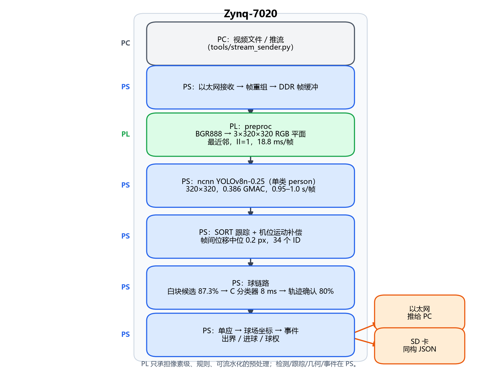

各模块关系：`preproc` 是检测的唯一输入；`track_preproc` 与 `preproc` 共用同一 IP 的两套输出；
`board_pipeline.py` 是 PS 侧调度中心；显示模块只消费已落盘/已推送的 JSONL，不反向影响检测；
`flow_system.bit` 把 LCD 与 HDMI 合并，避免赛中换片导致 PS 句柄失效。

**视频入口（D015/D027）**：上电后板端跑两个 systemd 服务——`zynq-idle`（加载比特流、HDMI 刷白待机）
与 `zynq-stream`（在 **5007/TCP** 等 PC 推流）。PC 侧 `tools/video_send.py` 或
`tools/pc_dashboard.py --push` 把视频按 `ZYVI` 魔数 + `[u32 len][JPEG q95]` 的帧协议推入，
板端解码后进入同一条处理管线；帧长 0 表示结束。**现场演示不需要在板子上做任何操作**。

### 2.2 硬件系统介绍

#### 2.2.1 硬件整体介绍

- 器件：Xilinx **XC7Z020-CLG400-2**（正点原子 领航者 ZYNQ 7020，底板 V3.7）。
- 资源上限：53 200 LUT6 / 106 400 FF / **220 DSP48** / **4.9 Mb BRAM** / 1 GB DDR3。
- 外设硬限制：无 MIPI D-PHY、无 HDMI 输入、无 GTX/GTH；DDR3 挂 PS 侧，PL 访问须走 AXI HP。
- 输入：D015 起主线视频由 PC 经以太网送入；板载 DVP 采集链退出主线。
- 输出：HDMI（TMDS，1280×720）与 LCD（800×480，4bpp/16 色，RGB 并口 + 按键）。
- 调试：Jupyter（9090）远程执行 Python；不依赖 SSH 免密。

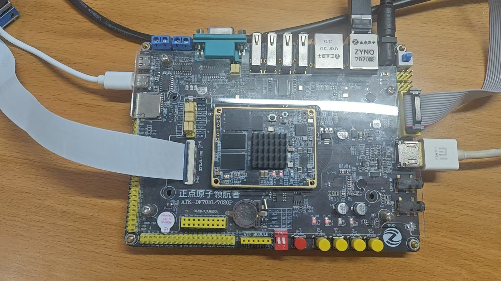

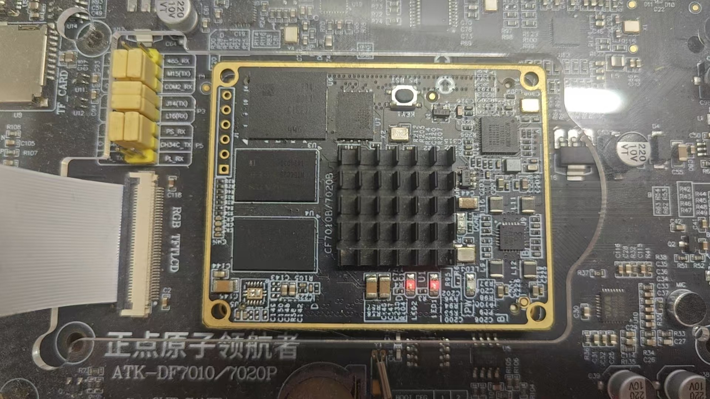

> 说明：以上为 2026-11-01 实拍（未通电）；「HDMI 与 LCD 同时点亮」的工作照仍在补拍清单里，
> 未拍到之前本报告不声称已拍到。

#### 2.2.2 机械设计介绍

本作品为板卡级电子系统，**无机械结构设计**；LCD 与开发板通过排线连接，整机以桌面摆放方式演示。
因此模板中的机械成果一节不适用。

#### 2.2.3 电路各模块介绍

- **PL 预处理核** `preproc`：输入 AXI-Stream BGR888，输出 3 个 320×320 平面；最近邻缩放，II=1；
  接口契约见 `docs/accel_interface.md`。
- **PL 跟踪辅助核** `track_preproc`：同一输入，另出 320×320 白/运动掩码；单 IP / 4 个 HP 端口，
  上板逐字节对拍通过。
- **AXI 拓扑**：PS `M_AXI_GP0`（83.33 MHz）配置寄存器；PL 数据通路走 `S_AXI_HP0`；
  HDMI 读主机与 pclk 74.25 MHz 必须同源，跨时钟处插 `axi_clock_converter`，
  否则实测 WNS −8.001 ns / 166 端点。
- **HDMI 输出**：外部 50 MHz 晶振（U18）→ `clk_wiz` 产生 74.25/371.25 MHz →`fb_scanout`
  （4 条行缓存）→ `video_driver` → `dvi_transmitter_top`（TMDS）。帧缓存经 AXI BRAM/HP 读写，
  配置口 `0x41200000`（通道 1 = 帧缓存物理地址，通道 2 = `{dbg_sel, test, en, width, stride}`），
  状态口 `0x41210000`（`{frames, under}`；通道 2 带调试选择器，见 §2.3.2 补正说明）。
- **LCD 输出**：独立 MMCM 产生 33.333 MHz；800×480 / Th 928 / Tv 525 / DE 模式；
  4bpp 打包（8 像素/字，最低 4 位为最左像素），16 色调色板在场消隐装载；配置口 `0x41220000`。
- **按键**：`key[0]=L14`、`key[1]=K16`，映射到 `0x41260000`；赛前选色 UI 已按 D028 删除，
  现在只作硬件自检时读取（`tools/lcd_probe.py --keys`），不参与主流程。

引脚与电平以 `build/scripts/*.xdc` 与底板 V3.7 原理图为准；仓库不使用 V3.9 的引脚文件。

### 2.3 软件系统介绍

#### 2.3.1 软件整体介绍

软件分三层：板上 PYNQ 驱动与调度（`tools/board_pipeline.py`）、结果存储与推送
（`result_store.py` / `result_stream.py`）、PC 上位机与显示（`pc_dashboard.py` /
`status_display.py` / `hdmi_video.py`）。所有模块以 JSONL 为统一数据契约，
因此检测、事件、显示、上位机可以分别替换而不互相绑定。

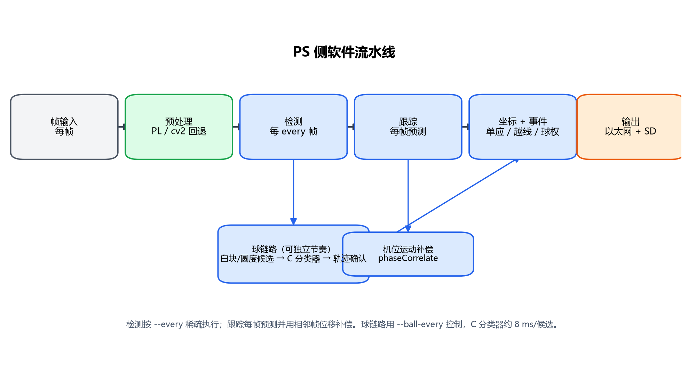

#### 2.3.2 软件各模块介绍

| 模块 | 关键输入 | 关键输出 | 说明 |
|---|---|---|---|
| `board_pipeline.py` | 网络帧（5007/5009）、标定 JSON | 每帧 JSONL | PS 侧调度：预处理 → 检测 → 跟踪 → 几何 → 球 → 事件 |
| `video_send.py` | 视频文件/摄像头 | TCP 帧 | PC 侧推流（`ZYVI` 协议，JPEG q95） |
| `preproc` 驱动 | BGR 帧 | 3×320×320 RGB | 经 overlay 寄存器与 DMA/流接口 |
| `track_players.py` | 检测框、帧 | 轨迹 ID、补偿位移 | 轻量 SORT + 相位相关 |
| `field_coords.py` | 6 点标定、像素点 | 球场米制坐标 | DLT 单应 + 机位有效性三态 |
| `ball_*` 系列 | ROI / 候选 | 球坐标、置信度 | 白块候选 + 3 层 C 分类器 + 轨迹确认 |
| `events.py` | 球场坐标、球状态 | 出界/进球/球权 | FIFA 整球过线口径；球权 3 m |
| `result_store.py` | JSONL 行 | SD 文件 + summary | fsync、轮转、证据帧限流 |
| `result_stream.py` | JSONL | TCP 帧 | 默认从 EOF 读，流程必须带 `--from-start` |
| `pc_dashboard.py` | TCP/回放/推流 | 球场画布、事件流、CSV | `--push` 一条命令闭环；`--demo` 现场演示 |
| `status_display.py` | JSONL/回放 | PNG 或 fb/BRAM | 8 项状态，800×480 / 1280×720 |
| `hdmi_video.py` | JSONL + 原视频 | 32bpp 帧缓存 | 画球员框、球圈、事件条；**起管线时标定并补正行内平移** |
| `check_full_flow.py` | 上述模块 | 令牌表 | 时间/配置/落盘/推流/面板 六步验收 |

**HDMI 行内平移的标定与补正（D031，实现要点）**：`hdmi_video.HdmiVideoOut` 在起管线时
向状态口写入调试选择器，用「源图只让第 j 列为 1」的单列探针反解「它落在屏幕第几列」，
五个探针点求出 K（屏幕列 = 源列 + K，mod 1280）；随后把每一帧按列索引 `buf[:, i] = src[:, (i+K) mod W]`
搬进帧缓存，再用同一探针**复测残余**。日志判据为 `HDMI_ALIGN shift=<K> residue=<残余>`，
残余 0 表示补正后逐列恒等。**注意 `0x41290000` 是坏地址**（被地址解码到状态 GPIO，
永远读回 `{frames, under}`），诊断必须走 `0x41210008` 的通道 2。

每个模块的失败都会打印明确令牌（如 `STORE_UNAVAILABLE`、`TEAM_ASSIGN_OFF`、`HDMI_ALIGN_FAIL`），
不静默继续；这也是后续能在板上快速定位问题的原因。

## 第三部分  完成情况及性能参数

### 3.1 整体介绍

最终实物由 Zynq-7020 开发板、HDMI 显示器、LCD 屏与 PC 上位机组成。板上运行 `flow_system.bit`，
PS 侧运行 `board_pipeline.py`；LCD 显示运行时状态面板，HDMI 显示带框视频；PC 端显示比赛画面 +
球场画布与事件流。**演示主路径是 `py tools/pc_dashboard.py --demo`**：它在 PC 上推入一段
10 s 的争抢素材，板端处理后把结果拉回 PC 回放，同时 HDMI 大屏显示带框画面、LCD 小屏显示事件面板。

> 【待补实物照片：正面、斜 45° 全局照；HDMI + LCD 同屏工作照；PC 上位机同框照】

### 3.2 工程成果

#### 3.2.1 机械成果

无机械结构，不适用。

#### 3.2.2 电路成果

- 自研 PL 数据通路：`preproc`、`track_preproc`、`conv_engine`（历史验证）、HDMI
  `fb_scanout`/`video_driver`、LCD 4bpp 读侧与调色板、AXI BRAM/GPIO。
- 出片与实现报告：`build/reports/resource/*.rpt`、`build/reports/timing/*.rpt`、
  `build/reports/drc/*.rpt`；现行 `flow_system.bit` 与 `.hwh` 在 `board/overlay/`。
- **交付比特流实况**：`flow_system.bit`（sha256 `1397ce68…`）
  **WNS +2.362 ns**（100 665 端点、0 failing）、Slice LUT **22 858 / 53 200（42.97%）**、
  BRAM **86/140（61.4%）**、DSP **4/220**；对应报告
  `build/reports/timing/flow_system_bd_timing.rpt`、`build/reports/resource/flow_system_bd_util.rpt`。
- **LCD**：`READBACK_OK bad=0 checked=10`（读侧自证），彩色状态面板与运行时面板均**经人眼确认**（`LCD_VISUAL_OK`）。
- **HDMI**：`under=0` 与帧计数正常（`BRAM_OK` 级）；整行循环平移**已定量并补正**——
  逐列打点 47 个点全部 K=414，接缝在源 866 → 屏 0，说明是**纯循环平移**（不是丢点或重复）；
  换一次起管线量到 K=415。补正后复测 **`HDMI_ALIGN shift=415 residue=0`**。
  ⚠️ 该结论只证明「列映射恒等、行号对得上」，**不证明屏上观感**：2026-10-31 曾在同一片 bit 上
  记录过 `HDMI_VISUAL_OK` 又在 20:23 复测后撤回，因此 **`HDMI_VISUAL_OK` 至今不记**，
  演示前需要人眼看屏。

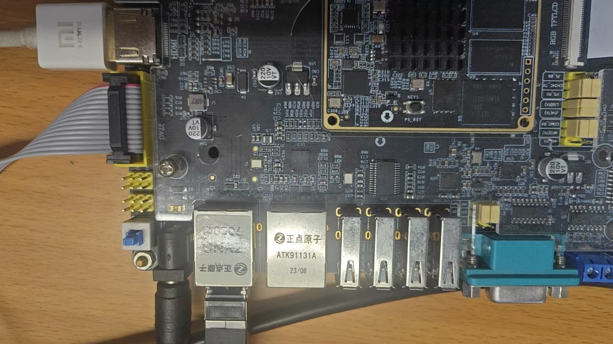

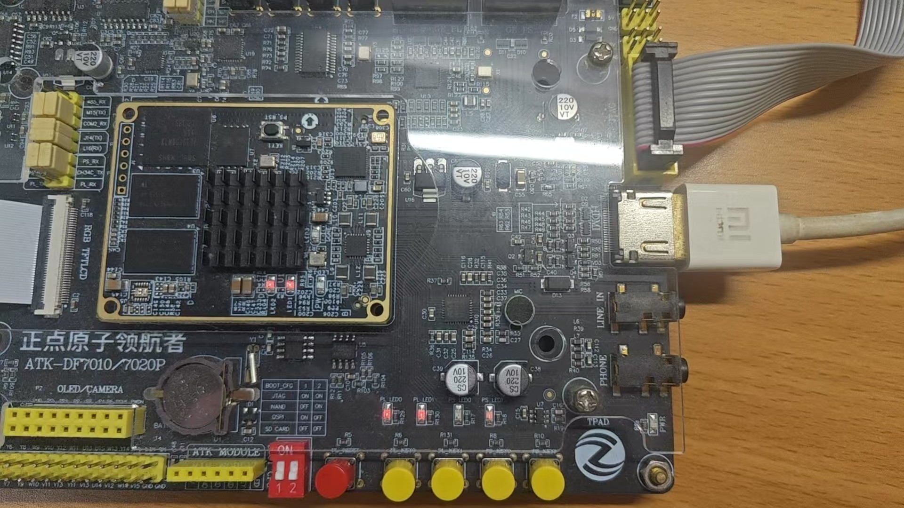

> 板端接线如图所示：HDMI 走 TMDS 输出到显示器，LCD 走 RGB 并口排线，视频输入不再使用板载 DVP，
> 改由 PC 经以太网送入（D015）。

#### 3.2.3 软件成果

- 板上管线、SD 存储、TCP 推流、PC Dashboard、LCD 运行时面板（D030）、HDMI 带框渲染全部可运行；
- **PC 端可直接看真比赛**：`pc_dashboard.py --video` 左栏显示原始比赛画面与检测框、球，
  与 LCD 面板、HDMI 环出共用**同一份** JSONL，三处显示不再各说各话；
- **一条命令演示**：`py tools/pc_dashboard.py --demo`（板端体检 → 事件管线 + HDMI 回显 +
  LCD 面板 → 推 c05 整段 250 帧 → 等管线退出 → 拉回 JSONL → 回放）；
- 主机侧自检令牌：`FULL_FLOW_OK`、`RESULT_STORE_OK`、`PC_DASHBOARD_SELFTEST OK`、
  `STATUS_DISPLAY_SELFTEST OK`、`TEAM_ASSIGN_SELFTEST OK`；
- 界面截图见 `report/figures/`（PC 球场、PC 比赛画面 + 球、LCD 状态面板、HDMI 带框图）。

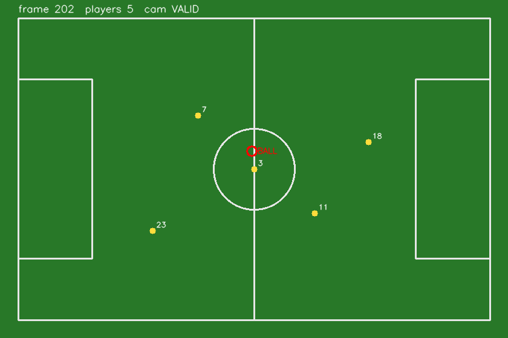
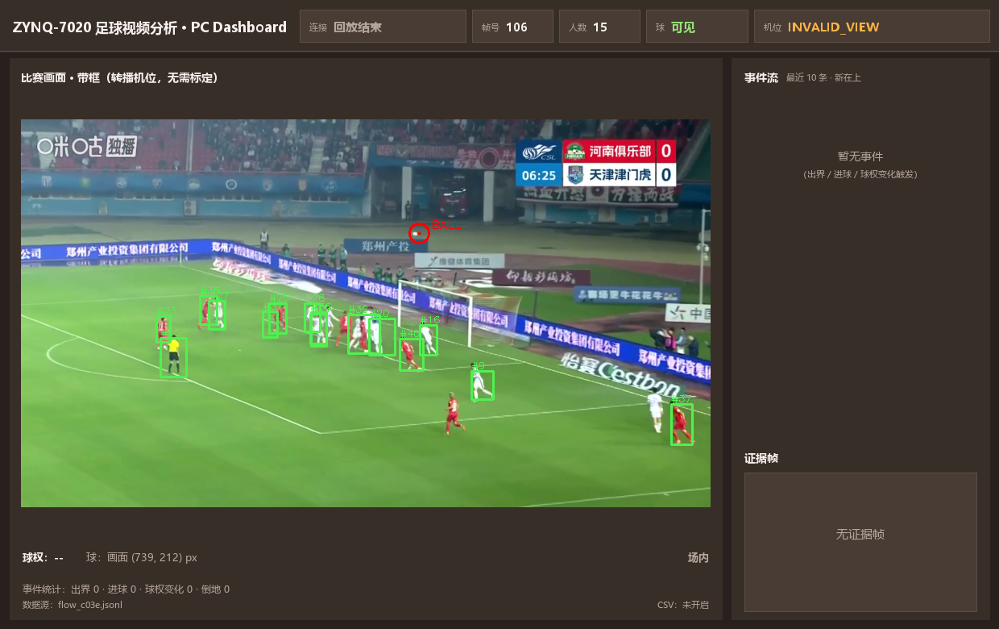
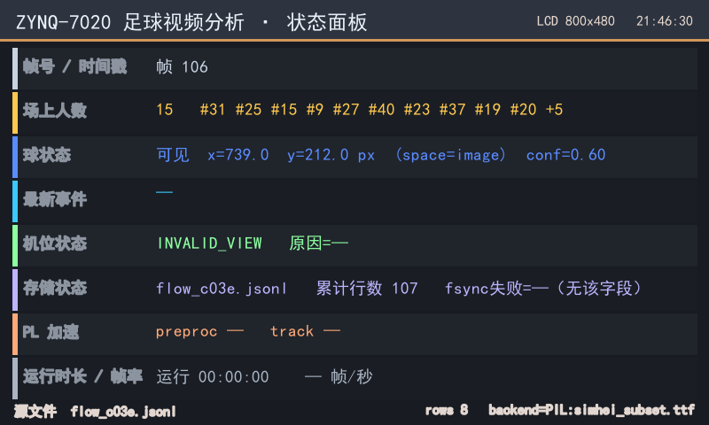
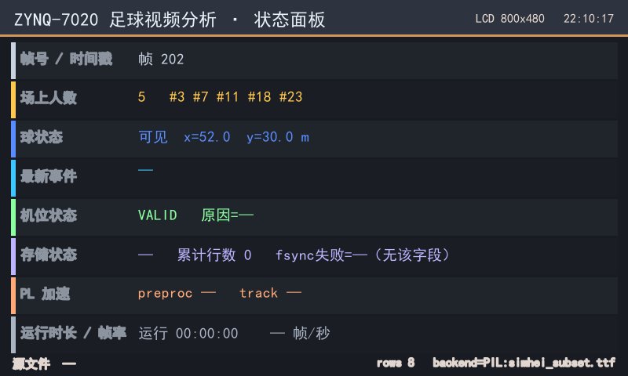
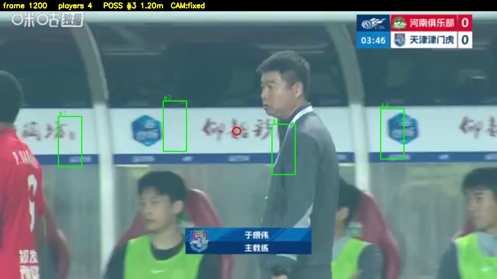

### 3.3 特性成果

| 功能 | 验收方式 | 结果 | 边界 |
|---|---|---|---|
| 球员检测/跟踪 | 板上运行 + 逐帧 JSON | 帧间位移 0.2 px；c05 整段 `TEAM_ASSIGN tracks=52` | 检测 0.95–1.0 s/帧，不是实时 |
| 球场坐标 | 6 点标定 + 残差统计 | 均值 1.11 m；中圈 0.33 m | 仅对已标定机位有效 |
| 足球定位 | 已知球片段 20 帧 | 确认 80%（16/20），15 px 内 | 快速移动/遮挡时下降 |
| 球分类器 | 板上 8 ms/候选 | P 0.667 / R 0.848 | 候选召回 87.3%，非端到端 |
| 事件（250 帧整段） | 板上现跑 + 拉回校验 | **32 帧**坐标球、**10 帧**球权、`out_of_play` 0 帧 | 第 167 帧起球跟丢，之后是外推值，不采信 |
| 存储/推流 | `RESULT_STORE_OK` / `RESULT_STREAM_OK` | 20 行 JSONL、PC 收到 20 帧 | 依赖 SD 挂载点 |
| PC 推流（D027） | 同一段 c03 走文件源与网络源对拍 | 两边 `frames=250 detections=17`，带球帧集合同为 20 帧 | JPEG 有损，档位影响判决（q80 多 10 帧假球 ⇒ 默认 q95）；摄像头源未验 |
| 上电即用（D029） | `install_boot.py` + 真重启 | `BOOT_SERVICE_STATE active active`；空闲白屏 `frames=31/35 under=0` | 白屏观感待人眼留档 |
| LCD 显示（D030） | `LCD_PANEL_OK` + 人眼 | 4bpp/16 色、每 5 帧刷新、整段 50 次 | — |
| HDMI 显示（D026+D031） | 单列探针 + 日志令牌 | `under=0`；**`HDMI_ALIGN shift=415 residue=0`** | **屏上观感待人眼**；K 跨运行会变，故必须每次标定 |
| 一键演示（`--demo`） | 真机整段跑通 | `PUSH_DONE 250 帧` → `BOARD_PIPELINE_EXITED after=31s` → `PULL_OK` → `PC_DASHBOARD_OK frames=250` | 端到端 8–10 分钟（板端反压） |
| 整链 | `FULL_FLOW_OK` | 主机 ok=6；板上 ok=8 | — |

## 第四部分  总结

### 可扩展之处

- **视频入口网络化（D015/D027）**：PC 推流已接进主线并与文件源验过等价；下一步是把
  `--camera` 实时源与长时段传输的丢帧/超时行为纳入验收。
- **队别与球权的板上验证**：目前只做到主机侧自证，需在真实画面与板上核对。
- **倒地识别升级**：从候选粗筛走到可度量召回的模型。
- **球链路结构改造**：按秒计丢失窗口、预测绕过边界仍未落地；候选质量是根因。
- **实时叠框回放的人眼验收**：把 `HDMI_ALIGN residue=0` 推到 `VISUAL_OK`。
- **吞吐**：事件模式 0.7 fps 是「检测 + 扫球 + 回显」三条成本叠加的结果，想真正实时得换架构
  （PL 预处理 + 小窗口），调参救不回来。

### 心得体会

这次项目最大的收获不是「跑通了什么」，而是学会了**先定义什么叫跑通**。最初我们也把
「帧缓存逐字读回一致」当成显示通过，结果屏上全黑；后来把判据拆成 `BRAM_OK` 与 `VISUAL_OK`
两级，返工才真正收敛。类似地，球帧数上涨不一定代表变好——人工抽查 38 帧新增球全不是球，
这条否定结论比一个漂亮的数字更有价值。

第二个收获是**用对照实验代替直觉**。PL 整网、PL 掩码、PL 预处理三条路线都实打实出片、上板、
量过时间；最后选择 PL 预处理 + PS ncnn，不是因为它听起来先进，而是因为 18.8 ms 与 0.95 s 摆在那里。
卷积引擎 6/6 bit-exact 但整网 9.63 s/帧，也让我们敢于把它降级为技术资产而不是主线。

第三个收获是**把「间歇故障」变成可测量的量**。HDMI 的整行错位曾让结论在「人眼说对」与
「复测又错」之间反复横跳，直到我们用单列探针把映射写成「屏幕列 = 源列 + K」，
才明白它不是随机的：K 恒定，但每次起管线会变。写死一个常数只会隔天再错，
所以最终做成**每次运行现场标定 + 补正 + 复测残余**。

第四个收获是**证据链纪律**。每次上板都留日志、令牌与 sha256；每个进报告的数字都能指回
`build/reports/`、`board/logs/` 或 `data/results/`。板子一天掉三次线，如果没有这些记录，
第二天就分不清「上次到底验到哪」。文档里我们也保留了失败与回滚，而不是只写成功。

最后是对异构系统的理解：7020 的瓶颈往往不是算力，而是**数据怎么喂进来、怎么送出去**。
AXI 带宽标定、HP0 与 pclk 同源、跨时钟隔离、BRAM 字节地址与字地址的差别，这些「不算法」的细节，
决定了系统能不能真正亮起来。把这些坑写成技能包与检查脚本，比多写一个算子更有复用价值。

### 附：指南 3.3.5.2 / 3.3.5.3 要求的对应位置

| 指南要求 | 本文/仓库位置 |
|---|---|
| 大模型协作记录（提示词、回答、自我纠错轨迹、智能体工作流） | `ai/sessions/001–027`（索引 `ai/sessions/INDEX.md`，含 ★ 纠错轨迹）；报告级摘录 `report/llm_logs/01–07` |
| 技能包（适用范围 / 使用方法 / 失效条件 / 提炼来源 / 已验证效果） | `skill/README.md`、`skill/hls_axi_stream_accel/`、`skill/pynq_overlay_bringup/`（通用 PYNQ 包） |
| 优化过程（前后对比） | `report/design_report.md` §4 |
| 复现说明 | `report/design_report.md` §7、根 `README.md` §5、`docs/streaming_quickstart.md` |
| 诊断与选型的完整推理 | `report/design_report.md` §1–§3 |

## 第五部分  参考文献

1. Xilinx. *Zynq-7000 SoC Technical Reference Manual* (UG585).
2. Xilinx. *Vivado Design Suite User Guide: Design Analysis and Closure Techniques* (UG906).
3. Xilinx. *Vitis High-Level Synthesis User Guide* (UG1399).
4. Xilinx. *AXI DMA and AXI-Stream Interconnect* 相关文档.
5. PYNQ Project. *PYNQ Documentation*.
6. Tencent. *ncnn: a high-performance neural network inference framework for mobile platforms*.
7. Ultralytics. *YOLOv8 Documentation*.
8. Bewley A., et al. Simple Online and Realtime Tracking. *ICIP*, 2016.
9. Hartley R., Zisserman A. *Multiple View Geometry in Computer Vision*. Cambridge University Press, 2004.
10. FIFA. *Laws of the Game 2023/24*.
